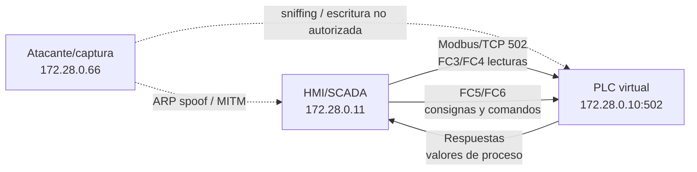

# Guía detallada — Trabajo en Grupo de Ciberseguridad Industrial

**Curso 2026/27 · GIIROB · Análisis de ciberseguridad de comunicaciones industriales**

Documento de apoyo elaborado a partir del enunciado `Trabajo Grupo CBI GIIROB v1.0.pdf` (5 páginas, profesor José Vera Pérez).

> **Cómo usar esta guía.** No sustituye al enunciado oficial: úsala para organizar el trabajo, entender qué se evalúa y producir evidencias. Antes de empezar, confirma con el profesor la fecha de entrega, el tamaño del grupo, la extensión máxima y si la actividad voluntaria suma sobre la nota final.

---

## 0. Índice

1. [Resumen del enunciado](#1-resumen-del-enunciado)
2. [Lectura crítica: qué se evalúa realmente](#2-lectura-crítica-qué-se-evalúa-realmente)
3. [Elección del escenario y del protocolo](#3-elección-del-escenario-y-del-protocolo)
4. [Escenario propuesto: planta de llenado de un depósito](#4-escenario-propuesto-planta-de-llenado-de-un-depósito)
5. [Diseño del laboratorio y reproducibilidad](#5-diseño-del-laboratorio-y-reproducibilidad)
6. [Guion experimental y capturas](#6-guion-experimental-y-capturas)
7. [Análisis del tráfico](#7-análisis-del-tráfico)
8. [MITRE ATT&CK for ICS](#8-mitre-attck-for-ics)
9. [Análisis de impacto sobre el proceso](#9-análisis-de-impacto-sobre-el-proceso)
10. [Detección y protección](#10-detección-y-protección)
11. [Actividad voluntaria: incidente real](#11-actividad-voluntaria-incidente-real)
12. [Estructura y redacción del informe](#12-estructura-y-redacción-del-informe)
13. [Organización del grupo y plan de trabajo](#13-organización-del-grupo-y-plan-de-trabajo)
14. [Checklist de entrega y autoevaluación](#14-checklist-de-entrega-y-autoevaluación)
15. [Riesgos, contingencias y preguntas para el profesor](#15-riesgos-contingencias-y-preguntas-para-el-profesor)
16. [Referencias](#16-referencias)
17. [Anexos](#17-anexos)

---

## 1. Resumen del enunciado

### 1.1. Datos generales

| Aspecto | Contenido |
|---|---|
| Asignatura | Ciberseguridad Industrial |
| Curso | 2026/27 |
| Titulación | GIIROB |
| Profesor | José Vera Pérez |
| Modalidad | Trabajo en grupo, entrega única |
| Título | Análisis de ciberseguridad de comunicaciones industriales |
| Enfoque | Desplegar un escenario virtualizado, capturar tráfico, identificar debilidades, relacionarlas con MITRE ATT&CK for ICS y analizar el impacto |

### 1.2. Objetivo

Desplegar un escenario de comunicación industrial virtualizado y realizar una evaluación básica de su ciberseguridad, combinando experimentación práctica con investigación y análisis de amenazas.

El enunciado insiste en que **no es necesario construir un proceso industrial complejo ni implementar un protocolo desde cero**. Se valora especialmente:

- La comprensión del funcionamiento del sistema.
- El análisis de las evidencias obtenidas.
- La justificación técnica de las decisiones de ciberseguridad.

### 1.3. Qué pide el trabajo, en una frase

Elegir un protocolo industrial, montar un pequeño laboratorio con dos o más componentes que intercambien datos, capturar y explicar el tráfico, identificar debilidades, estudiar al menos dos técnicas de MITRE ATT&CK for ICS, analizar el impacto de la amenaza más relevante y proponer medidas de detección y protección para una planta real.

### 1.4. Objetivos de aprendizaje

Al finalizar, el grupo debe ser capaz de:

1. Comprender el funcionamiento de un protocolo de comunicaciones industriales y su aplicación en un proceso real.
2. Desplegar un entorno virtualizado sencillo que reproduzca el intercambio de información entre dispositivos o aplicaciones industriales.
3. Capturar, interpretar y documentar tráfico de red con Wireshark.
4. Identificar debilidades y posibles vectores de ataque asociados al protocolo y a su configuración.
5. Investigar y relacionar amenazas con técnicas documentadas en MITRE ATT&CK for ICS.
6. Analizar las consecuencias de un ciberataque sobre la operación de una instalación industrial.

### 1.5. Ponderación

| Bloque | Peso | Qué se evalúa |
|---|---:|---|
| 4.1 Descripción del escenario industrial | 15 % | Proceso, actores, protocolo, variables, operaciones, arquitectura y uso en una planta real |
| 4.2 Despliegue y análisis del tráfico | 25 % | Reproducibilidad, captura, interpretación, evidencias y ausencia/presencia de mecanismos de seguridad |
| 4.3 Investigación de amenazas con MITRE ATT&CK for ICS | 35 % | Rigor, relación con el escenario, condiciones, evidencias, consecuencias y justificación |
| 4.4 Análisis del impacto sobre el proceso | 25 % | Escenario de ataque, condiciones, efectos y priorización de la amenaza |
| 5. Actividad voluntaria: incidente real | 15 % | Incidente documentado, consecuencias, similitudes y fuentes |

**Interpretación:** los bloques 4.1 a 4.4 suman el 100 %. La actividad voluntaria indica un 15 % adicional; confirma con el profesor si se suma a la nota o si forma parte de otra escala. En cualquier caso, **el 60 % de la nota está en el análisis (4.3 + 4.4)**, no en la complejidad del montaje.

### 1.6. Entregables

1. **Memoria técnica en PDF.**
2. **Evidencias y archivos técnicos:**
   - Archivos **PCAP/PCAPNG** originales.
   - Archivo `compose.yml` o instrucciones equivalentes para reproducir el entorno.
   - **Scripts o configuraciones** desarrollados o modificados, cuando corresponda.

La entrega es **única por grupo**. No se entregan carpetas separadas por miembro; el grupo debe integrar y revisar todo.

### 1.7. Escenarios admitidos

| Protocolo | Proceso sugerido | Herramientas orientativas |
|---|---|---|
| Modbus/TCP | PLC virtual y HMI intercambian registros de proceso | PyModbus |
| MQTT | Sensores industriales publican variables hacia un sistema de supervisión | Eclipse Mosquitto y clientes MQTT |
| OPC UA | Servidor industrial expone variables y un cliente las consulta o modifica | open62541 o Python `opcua-asyncio` |
| Otro | Debe validarse antes con el profesor | Depende del protocolo |

Requisitos mínimos:

- Al menos **dos componentes** que intercambien información por una red virtual.
- Se pueden añadir elementos adicionales si el protocolo lo necesita (por ejemplo, el broker en MQTT).
- Proceso sencillo: temperatura, nivel de un depósito, supervisión de una bomba, consignas de velocidad, monitorización de variables de una máquina, etc.
- Definir qué representa cada variable, cómo se intercambia y qué consecuencias tendría su manipulación.

### 1.8. Contenido obligatorio de cada bloque

**4.1 Descripción del escenario (15 %)**

- Dispositivos o aplicaciones que participan y su función.
- Protocolo utilizado y características principales.
- Variables de proceso intercambiadas.
- Operaciones: lectura, escritura, publicación, suscripción, etc.
- Esquema sencillo de arquitectura y comunicaciones.
- Explicación de cómo se usaría en una planta industrial real.

**4.2 Despliegue y análisis del tráfico (25 %)**

- Despliegue con Docker/Podman o solución equivalente justificada.
- Generación y observación de tráfico.
- Capturas con Wireshark, tcpdump u otra herramienta compatible.
- Documentar:
  - Direcciones IP, puertos y participantes.
  - Mensajes y operaciones características.
  - Al menos dos operaciones o intercambios representativos, incluyendo alguna modificación o actualización de datos.
  - Variables o información del proceso observables.
  - Presencia o ausencia de autenticación, cifrado o protección de mensajes.
- **PCAP/PCAPNG original obligatorio**, identificando en el informe los paquetes que justifican el análisis.
- No basta con capturas de pantalla sin interpretación.

**4.3 MITRE ATT&CK for ICS (35 %)**

- Al menos **dos técnicas** relacionadas con el escenario.
- Para cada técnica:
  - Identificador y denominación.
  - Descripción del comportamiento del atacante.
  - Condiciones necesarias.
  - Relación con el protocolo o la arquitectura.
  - Posibles evidencias de ejecución.
  - Consecuencias potenciales para el proceso.
- La selección debe estar justificada.
- No basta con enumerar técnicas: hay que explicar su relación con el proceso.
- Diferenciar claramente entre **vulnerabilidades observadas**, **ataques técnicamente posibles** y **comportamientos demostrados experimentalmente**.

**4.4 Análisis del impacto (25 %)**

- Seleccionar la amenaza más relevante y desarrollar un escenario hipotético de ataque.
- Explicar cómo actuaría el atacante, qué condiciones necesitaría y qué efectos produciría.
- Considerar disponibilidad, integridad de variables, continuidad del servicio, calidad de producción y seguridad del proceso.
- Justificar por qué se considera prioritaria esa amenaza.

**5. Actividad voluntaria (15 %)**

- Investigar un incidente real documentado, relacionado con el protocolo, una técnica MITRE seleccionada o una amenaza semejante.
- Explicar qué ocurrió, qué consecuencias tuvo y qué similitudes existen con el escenario.
- La relación puede ser por el procedimiento del atacante, aunque el incidente use otro protocolo.
- Máximo una página, con fuentes.

---

## 2. Lectura crítica: qué se evalúa realmente

### 2.1. El reparto de esfuerzo correcto

Con la ponderación en la mano, el esfuerzo debería parecerse a esto:

| Actividad | Esfuerzo orientativo | Por qué |
|---|---:|---|
| Montaje del laboratorio | 20–25 % | Es necesario, pero no es el objetivo final; no sobreingenierizar |
| Captura y análisis de tráfico | 20–25 % | Genera las evidencias que sostienen todo el informe |
| MITRE ATT&CK for ICS | 25–30 % | Es el bloque con más peso (35 %) |
| Impacto y priorización | 15–20 % | Es el otro bloque grande (25 %) |
| Redacción e integración | 10–15 % | Un buen análisis mal explicado pierde puntos |

Un error típico es dedicar dos semanas a Docker y dos días a MITRE. El enunciado premia la comprensión y la justificación, no la complejidad del despliegue.

### 2.2. Las tres categorías que el profesor quiere ver separadas

El enunciado pide explícitamente diferenciar:

| Categoría | Definición | Ejemplo en Modbus/TCP |
|---|---|---|
| **Vulnerabilidad observada** | Debilidad que se deduce del protocolo, la configuración o el tráfico capturado | Modbus/TCP no autentica ni cifra; el puerto 502 está accesible desde toda la red del laboratorio |
| **Ataque técnicamente posible** | Ataque que podría ejecutarse con las condiciones adecuadas, aunque no se haya demostrado en el laboratorio | ARP spoofing para modificar respuestas Modbus y engañar al HMI |
| **Comportamiento demostrado** | Ataque ejecutado y evidenciado con capturas, logs o cambios en el proceso | Escritura FC6 de la consigna de nivel desde el contenedor atacante y subida real del nivel |

Incluye una tabla o un párrafo con esta distinción. Es una de las formas más sencillas de demostrar rigor.

### 2.3. Errores que penalizan

| Error | Por qué es grave | Cómo evitarlo |
|---|---|---|
| Elegir un protocolo complejo y no llegar al análisis | El 60 % de la nota está en el análisis | Modbus/TCP o MQTT; evitar OPC UA si no hay experiencia |
| Enseñar capturas de Wireshark sin interpretar | El enunciado lo prohíbe expresamente | Explicar campos, valores, función y consecuencia de cada paquete |
| Confundir vulnerabilidad con ataque | Se pierde rigor | Usar la tabla de las tres categorías |
| Copiar descripciones de MITRE sin relación con el escenario | El enunciado lo prohíbe | Cada técnica debe tener condiciones, evidencias y consecuencias propias |
| Analizar solo confidencialidad | El impacto industrial es físico | Incluir integridad, disponibilidad y seguridad del proceso |
| PCAP inexistente o con tráfico irrelevante | Es un requisito obligatorio | Capturar solo el laboratorio y referenciar frames concretos |
| IP/puertos incoherentes entre informe y compose | Rompe la reproducibilidad | Una única tabla de direccionamiento y revisión cruzada |
| Dejar la integración para el final | Es el fallo más común | Congelar contenido 48 h antes y hacer una prueba desde cero |

### 2.4. Qué significa “justificar técnicamente”

No basta con decir “Modbus es inseguro”. Hay que escribir algo como:

> Modbus/TCP no define autenticación, cifrado ni integridad a nivel de protocolo. En la captura, la petición FC6 del frame 128 viaja en texto claro y cualquier host con conectividad al puerto 502 puede reproducirla. El servidor no distingue si el cliente es el HMI legítimo o el contenedor atacante; solo comprueba que la dirección sea válida. Por eso la escritura de la consigna en el frame 128 fue aceptada y el nivel comenzó a subir en los frames 130–190.

Eso es análisis: protocolo + evidencia + consecuencia.

### 2.5. Enfoque recomendado

1. **Semana 1:** elegir escenario, definir variables y arquitectura, montar el esqueleto.
2. **Semana 2:** conseguir tráfico normal, capturarlo y analizarlo; primera escritura no autorizada.
3. **Semana 3:** investigación MITRE, impacto, medidas de protección y, si da tiempo, MITM/DoS.
4. **Semana 4:** integración, reproducibilidad, revisión y entrega.

La guía desarrolla este plan en la sección 13.

---

## 3. Elección del escenario y del protocolo

### 3.1. Comparativa

| Criterio | Modbus/TCP | MQTT | OPC UA |
|---|---|---|---|
| Complejidad de montaje | Baja | Baja-media | Media-alta |
| Modelo | Cliente/servidor | Publicación/suscripción con broker | Cliente/servidor con servicios |
| Puerto habitual | 502/TCP | 1883/TCP (8883 con TLS) | 4840/TCP |
| Seguridad nativa | Ninguna | Usuario/contraseña, TLS y ACL configurables | Certificados, firmas, cifrado y autenticación |
| Facilidad para mostrar debilidades | Muy alta | Alta si se configura sin TLS/ACL | Media: es seguro por diseño; hay que buscar mala configuración |
| Herramientas | PyModbus, mbtget, Wireshark | Mosquitto, `mosquitto_pub/sub`, MQTT Explorer | open62541, `opcua-asyncio`, UaExpert |
| Relación con MITRE | Muy directa | Directa | Directa |
| Riesgo de quedarse sin tiempo | Bajo | Bajo | Alto |
| Recomendación | **Primera opción** | Buena alternativa | Solo con experiencia previa |

### 3.2. Recomendación: Modbus/TCP

Para este enunciado, Modbus/TCP es la opción más eficiente por estas razones:

- Es un protocolo **cliente/servidor simple**, con peticiones y respuestas fáciles de identificar en Wireshark.
- **No tiene autenticación, cifrado ni integridad**, lo que permite demostrar debilidades sin tener que “romper” configuraciones artificialmente.
- El mapa de registros se traduce directamente en variables de proceso: nivel, temperatura, consigna, bomba.
- Permite demostrar **lectura no autorizada**, **escritura no autorizada**, **sniffing**, **MITM** y **DoS** con herramientas sencillas.
- Tiene abundante documentación y ejemplos, y una relación clara con técnicas de MITRE ATT&CK for ICS.
- El montaje con Docker es pequeño: PLC virtual, HMI y un contenedor de captura/ataque.

### 3.3. Cuándo elegir MQTT

MQTT es una buena alternativa si el grupo quiere explorar:

- Broker como elemento central y **ACL por tópico**.
- Autenticación con usuario/contraseña o certificados de cliente.
- TLS y comparación entre configuración segura e insegura.
- Enumeración de tópicos, publicación no autorizada y suplantación de sensores.

Es especialmente interesante si el grupo quiere demostrar **cómo una mala configuración del broker** anula las protecciones que el protocolo sí ofrece. El esfuerzo es algo mayor que Modbus, pero sigue siendo asumible.

### 3.4. Cuándo elegir OPC UA

OPC UA es la opción más rica en seguridad, pero también la más costosa de montar:

- Certificados, confianza mutua, políticas de seguridad y modos de autenticación.
- Address Space, nodos, servicios y sesiones.
- Herramientas como UaExpert y `opcua-asyncio`.

Si el grupo elige OPC UA, el análisis debe centrarse en **malas configuraciones** (por ejemplo, `SecurityPolicy: None`, usuarios anónimos, certificados no verificados), no en afirmar que OPC UA es inseguro. Es fácil que el montaje consuma el tiempo del análisis.

### 3.5. Checklist de decisión

Antes de confirmar el protocolo, el grupo debería responder:

- [ ] ¿Tenemos Docker Desktop o Podman funcionando en al menos dos equipos?
- [ ] ¿Alguien del grupo puede escribir y depurar Python con soltura?
- [ ] ¿Podemos dedicar 3–4 semanas al trabajo?
- [ ] ¿Queremos demostrar un impacto físico (nivel, bomba, temperatura)?
- [ ] ¿El protocolo elegido está aprobado por el profesor?
- [ ] ¿Tenemos un plan B si la red de Docker no permite ARP spoofing?
- [ ] ¿Sabemos qué técnicas de MITRE vamos a investigar antes de montar el laboratorio?

Si alguna respuesta es “no”, Modbus/TCP reduce el riesgo.

### 3.6. Propuesta de escenario para enviar al profesor

> **Asunto:** Propuesta de escenario — Trabajo en Grupo CBI
>
> Hola José:
>
> El grupo [integrantes] propone trabajar con **Modbus/TCP** en un escenario de **control de nivel de un depósito**. El laboratorio constará de un PLC virtual (PyModbus) que expone nivel, temperatura, consigna y estado de bomba; un HMI que consulta y modifica variables; y un contenedor de captura/análisis en una red Docker aislada. Analizaremos el tráfico con Wireshark, demostraremos lectura y escritura no autorizadas y relacionaremos el comportamiento con técnicas de MITRE ATT&CK for ICS (T0842, T0861, T0836 y T0830), además de proponer medidas de detección y protección.
>
> ¿Le parece adecuado el alcance? Quedamos a la espera de su confirmación.
>
> Gracias y un saludo.

---

## 4. Escenario propuesto: planta de llenado de un depósito

> Esta sección es una propuesta completa. Si el grupo elige otro proceso, mantén la misma estructura: actores, protocolo, variables, operaciones, arquitectura y uso real.

### 4.1. Descripción del proceso

Una planta de llenado dispone de un depósito de agua (o de un producto líquido) alimentado por una bomba. El PLC controla la bomba y calcula el nivel a partir de un sensor. El HMI muestra el nivel, la temperatura, el caudal y la presión, permite cambiar la consigna de nivel y arrancar o parar la bomba. Un operador vigila el proceso desde la sala de control.

El objetivo del lazo es mantener el nivel alrededor de una consigna (por ejemplo, 60 %). Si el nivel supera el 90 %, se activa una alarma de nivel alto. En una planta real, esta alarma debería complementarse con un **Sistema Instrumentado de Seguridad (SIS)** independiente, con su propio sensor y su propia lógica de parada. En el laboratorio no se implementa el SIS para poder observar el efecto de la manipulación.

### 4.2. Actores y funciones

| Actor | Implementación | Función | Dirección prevista |
|---|---|---|---|
| PLC virtual | `plc_server.py` con PyModbus | Simula el proceso, mantiene registros y atiende peticiones Modbus | 172.28.0.10:502 |
| HMI/SCADA | `hmi_client.py` | Consulta variables, muestra el proceso y escribe consignas/comandos | 172.28.0.11 |
| Captura | `tcpdump` en el PLC | Captura todo el tráfico que pasa por el PLC (HMI y atacante) | 172.28.0.10 |
| Captura HMI (opcional) | Contenedor `capture` | Vista del HMI; no ve el tráfico del atacante | Comparte red del HMI |
| Atacante | `attack_write.py` / cliente Modbus | Lee y escribe variables sin autorización | 172.28.0.66 |
| Opcional: IDS | Suricata/Zeek offline | Detecta escrituras anómalas sobre el PCAP | Fuera de la red o en un contenedor aparte |

### 4.3. Protocolo: Modbus/TCP

Características que deben explicarse en el informe:

- **Modelo cliente/servidor** sobre TCP, puerto 502.
- **MBAP header** de 7 bytes: Transaction ID (2), Protocol ID (2, normalmente 0), Length (2), Unit ID (1).
- **PDU**: Function Code (1 byte) + datos.
- **Function codes** habituales:
  - FC1: leer coils.
  - FC2: leer entradas discretas.
  - FC3: leer registros de retención (*holding registers*).
  - FC4: leer registros de entrada.
  - FC5: escribir un coil.
  - FC6: escribir un registro.
  - FC15/FC16: escribir múltiples coils/registros.
- **Big-endian** para los valores de 16 bits.
- **Sin autenticación, autorización, cifrado, integridad ni protección contra replay.**
- El **Unit ID** identifica al esclavo, pero no es un mecanismo de autenticación.
- Las **excepciones** se devuelven con el bit 0x80 activado en el function code (por ejemplo, 0x83) y un código de excepción.
- Existe **Modbus/TCP Security** (TLS, puerto 802), pero su adopción es limitada; en el laboratorio se usa Modbus/TCP clásico para analizar el caso más común.

### 4.4. Variables de proceso

| Variable | Tag | Dirección Modbus | Tipo | FC | Escala | Quién escribe | Significado |
|---|---|---|---|---|---|---|---|
| Nivel | `LT-101` | HR 0 (40001) | uint16 | 3 | valor/10 % | PLC | Nivel actual del depósito |
| Temperatura | `TT-101` | HR 1 (40002) | uint16 | 3 | valor/10 °C | PLC | Temperatura del líquido |
| Consigna de nivel | `SP-101` | HR 2 (40003) | uint16 | 3/6 | % (0–100) | HMI / atacante | Nivel objetivo |
| Consigna de velocidad | `PV-101` | HR 3 (40004) | uint16 | 3/6 | rpm | HMI / atacante | Velocidad de la bomba |
| Marcha de bomba | `P-101` | CO 0 (00001) | bool | 1/5 | 0/1 | HMI / atacante | Orden de marcha |
| Reset de alarma | `RESET` | CO 1 (00002) | bool | 1/5 | 0/1 | HMI | Reconocimiento de alarma |
| Nivel alto | `LS-101` | DI 0 (10001) | bool | 2 | 0/1 | PLC | Contacto de nivel alto |
| Caudal | `FT-101` | IR 0 (30001) | uint16 | 4 | valor/10 L/min | PLC | Caudal de impulsión |
| Presión | `PT-101` | IR 1 (30002) | uint16 | 4 | valor/10 bar | PLC | Presión de descarga |

**Convención de direcciones:** en el código se usa `zero_mode=True`, por lo que la dirección `0` corresponde a `40001` en la notación tradicional. Deja esta convención escrita en el informe para evitar confusiones.

### 4.5. Operaciones

| Operación | Origen → Destino | FC | Frecuencia | Descripción |
|---|---|---|---|---|
| Lectura de nivel y temperatura | HMI → PLC | 3 | 1 s | Consulta de HR 0–3 |
| Lectura de caudal y presión | HMI → PLC | 4 | 1 s | Consulta de IR 0–1 |
| Lectura de nivel alto | HMI → PLC | 2 | 1 s | Consulta de DI 0 |
| Lectura de estado de bomba | HMI → PLC | 1 | 1 s | Consulta de CO 0–1 |
| Cambio de consigna | HMI → PLC | 6 | Al inicio / manual | Escritura de HR 2 |
| Cambio de velocidad | HMI → PLC | 6 | Al inicio / manual | Escritura de HR 3 |
| Marcha/paro de bomba | HMI → PLC | 5 | Según nivel | Escritura de CO 0 |
| Escritura no autorizada | Atacante → PLC | 6/5 | Manual | Cambio de consigna y/o bomba |

### 4.6. Arquitectura y comunicaciones

```text
                         Red Docker ics_net 172.28.0.0/24
 ┌────────────────┐          Modbus/TCP 502           ┌────────────────┐
 │ HMI / SCADA    │ ────────────────────────────────▶ │ PLC virtual    │
 │ 172.28.0.11    │ ◀──────────────────────────────── │ 172.28.0.10    │
 │ Python client  │   FC1/2/3/4 lecturas, FC5/6 esc.  │ PyModbus server│
 └───────┬────────┘                                   └───────┬────────┘
         │                                                    │
         │        ┌──────────────────────────┐                │
         └───────▶│ Atacante / captura       │◀───────────────┘
                  │ 172.28.0.66              │
                  │ tcpdump, pymodbus, scapy │
                  └──────────────────────────┘
```

Versión Mermaid (si el visor la soporta):



**Punto clave para el informe:** explica que la red del laboratorio es plana a propósito. En una planta real, PLC y HMI estarían en una zona OT segmentada, con un conducto controlado y un firewall industrial; esa diferencia es la base de las medidas de protección de la sección 10.

### 4.7. Uso en una planta industrial real

El escenario se puede trasladar a:

- Estaciones de tratamiento de agua.
- Dosificación de productos químicos.
- Llenado de depósitos en alimentación o bebidas.
- Riego y gestión de agua en agricultura.
- Control de nivel en procesos químicos.
- Sistemas de bombeo y presión.

En todas ellas, el PLC controla actuadores y el HMI permite supervisar y cambiar consignas. La manipulación de una consigna o de una medida puede provocar desbordamientos, falta de producto, dosificación incorrecta, cavitación de la bomba, paradas no planificadas o riesgos para las personas y el medio ambiente.

### 4.8. Consecuencias posibles de la manipulación

| Variable manipulada | Manipulación | Efecto inmediato | Consecuencia potencial |
|---|---|---|---|
| Nivel (`LT-101`) | Valor falso bajo | El operador cree que falta llenar | Desbordamiento |
| Nivel (`LT-101`) | Valor falso alto | El operador cree que está lleno | Parada innecesaria, falta de suministro |
| Consigna (`SP-101`) | Subir a 95–100 % | La bomba trabaja más tiempo | Desbordamiento, vertido |
| Bomba (`P-101`) | Forzar marcha | Llenado continuo | Desbordamiento, sobrepresión |
| Bomba (`P-101`) | Forzar paro | Proceso se detiene | Falta de servicio, pérdida de producción |
| Velocidad (`PV-101`) | Subir a 3000 rpm | Más caudal y presión | Cavitación, daño mecánico, golpe de ariete |
| Temperatura (`TT-101`) | Valor falso | Dosificación o calentamiento incorrecto | Calidad, seguridad química |
| Nivel alto (`LS-101`) | Anular o engañar | No se detecta el nivel alto | Desbordamiento sin alarma |

### 4.9. Alcance y supuestos

- Proceso simplificado, sin dinámica térmica ni hidráulica real.
- PLC virtual, no un PLC físico; no hay requisitos de tiempo real.
- Sin SIS independiente, para poder observar el efecto del ataque.
- Red aislada, sin conexión a Internet.
- No se persigue una auditoría completa ni una certificación IEC 62443; se aplican sus principios como marco de análisis.

---

## 5. Diseño del laboratorio y reproducibilidad

### 5.1. Herramientas recomendadas

| Herramienta | Versión orientativa | Uso |
|---|---|---|
| Docker Desktop / Docker Engine + Compose | 4.x / 24.x o superior | Contenedores y red aislada |
| Podman + `podman compose` | 4.x/5.x | Alternativa a Docker |
| Python | 3.12 | Scripts del PLC, HMI y ataque |
| PyModbus | 3.7.4 (fijada) | Servidor y cliente Modbus/TCP |
| Wireshark | 4.x | Análisis de PCAP |
| tcpdump | 4.99+ | Captura dentro del contenedor |
| Git | 2.x | Control de versiones |
| Opcional: Scapy | 2.6+ | Manipulación de paquetes y MITM |
| Opcional: Suricata/Zeek | 7.x/6.x | Detección offline sobre PCAP |

Fija las versiones en `requirements.txt` y en el `Dockerfile`. Un trabajo reproducible no dice “funciona en mi máquina”; dice “con estas versiones y este comando, funciona en cualquier máquina”.

### 5.2. Estructura del repositorio

```text
trabajo-cbi/
├── README.md                 # Cómo reproducir el laboratorio
├── compose.yml               # Definición de servicios y red
├── Dockerfile                # Imagen común
├── requirements.txt          # Versiones fijadas
├── plc_server.py             # PLC virtual
├── hmi_client.py             # HMI/SCADA
├── attack_write.py           # Escritura no autorizada
├── capture.sh                # Ayuda de captura
├── captures/                 # PCAP/PCAPNG (no versionar los grandes)
├── docs/
│   ├── informe.md            # Borrador de la memoria
│   ├── figuras/
│   └── referencias.bib
└── evidence/
    ├── logs/
    └── capturas_pantalla/
```

### 5.3. Plan de direccionamiento

| Host | IP | Puerto | Función |
|---|---|---|---|
| PLC | 172.28.0.10 | 502/TCP | Servidor Modbus |
| HMI | 172.28.0.11 | Efímero | Cliente Modbus |
| Captura | Comparte red del HMI | — | tcpdump |
| Atacante | 172.28.0.66 | Efímero | Cliente Modbus / sniffing / ARP |
| Host (opcional) | — | 1502 → 502 | Wireshark o `mbtget` desde el equipo anfitrión |

No publiques el puerto 502 en el host salvo que lo necesites. En una planta real, exponer el PLC a la red corporativa o a Internet es una mala práctica; en el laboratorio, la red aislada evita accidentes.

### 5.4. Piezas del `compose.yml`

El archivo completo está en `laboratorio/compose.yml`. Los elementos que debes saber explicar:

- **`build: .`**: una única imagen con Python, PyModbus, tcpdump y utilidades.
- **`networks.ics_net`**: red bridge con subred `172.28.0.0/24`; IPs fijas para que el informe y las capturas coincidan.
- **`depends_on` + `healthcheck`**: el HMI espera a que el PLC esté escuchando.
- **`capture` con `network_mode: "service:hmi"`**: comparte el namespace de red del HMI y ve todo su tráfico. Es útil para la vista del HMI, pero **no ve el tráfico de otros contenedores** (por ejemplo, la escritura del atacante).
- **Captura en el PLC**: `docker compose exec plc tcpdump ...`. Como todo el tráfico del proceso pasa por el PLC, esta captura ve las peticiones y respuestas del HMI y del atacante. Es la opción recomendada para las evidencias principales.
- **`attacker` con `NET_ADMIN` y `NET_RAW`**: necesario para tcpdump y, opcionalmente, ARP spoofing.
- **Volúmenes**: `./:/app` para editar scripts sin reconstruir; `./captures:/captures` para conservar los PCAP.

### 5.5. El problema del sniffing en Docker (importante)

En una red bridge de Docker, el tráfico **unicast** entre HMI y PLC no se difunde a todos los contenedores. Un contenedor atacante cualquiera **no verá** ese tráfico por defecto, aunque esté en la misma subred. Si el informe dice “capturé el tráfico desde el atacante” sin más, probablemente sea falso o esté mal justificado.

Opciones válidas:

| Opción | Ventaja | Limitación |
|---|---|---|
| **Captura en el PLC** (`tcpdump` dentro del contenedor) | Ve todo el tráfico del proceso: HMI y atacante | Es un punto de observación privilegiado, no un atacante externo; requiere `NET_RAW` |
| **Sidecar de captura** que comparte el namespace del HMI | Fiable y sencillo; ve todas las peticiones y respuestas del HMI | No ve el tráfico del atacante; es un punto de observación en el endpoint |
| **ARP spoofing** desde el contenedor atacante | Demuestra MITM real; el tráfico pasa por el atacante | Puede fallar según la configuración de Docker; requiere `NET_ADMIN` y forwarding |
| **Proxy TCP** entre HMI y PLC | Controlado y reproducible; permite ver y modificar | Cambia la topología; el HMI apunta al proxy |
| **Máquinas virtuales con switch virtual en modo promiscuo** | Se acerca a una red real | Más recursos y configuración |

Recomendación para el trabajo: usar la **captura en el PLC** para la evidencia principal (ve HMI y atacante) y, si se quiere, el **sidecar del HMI** para comparar la vista del operador. Si se quiere demostrar MITM, intentar **ARP spoofing** y documentar el resultado. Si no funciona, describirlo como “técnicamente posible” y usar un proxy o VMs como alternativa. Esta honestidad suma puntos, no resta.

### 5.6. Arranque y comprobaciones

```bash
cd laboratorio
docker compose up -d --build
docker compose ps
docker compose logs -f plc
```

En otra terminal:

```bash
docker compose logs -f hmi
```

Comprueba:

- [ ] El PLC escucha en 502.
- [ ] El HMI muestra nivel, temperatura, consigna, bomba, caudal y presión.
- [ ] El HMI actualiza cada segundo.
- [ ] El PLC permite ejecutar `tcpdump` (capacidad `NET_RAW`).
- [ ] El contenedor `capture` está en ejecución (opcional, para la vista del HMI).
- [ ] El atacante puede hacer `ping plc` y conectar al puerto 502.
- [ ] Los logs no muestran errores de versión ni de conexión.

### 5.7. Reproducibilidad

Un compañero o el profesor debería poder ejecutar el laboratorio desde cero. Para ello:

- [ ] `README.md` con requisitos, comandos y solución de problemas.
- [ ] Versiones fijadas (`pymodbus==3.7.4`, imagen `python:3.12-slim`).
- [ ] Sin rutas absolutas ni credenciales personales.
- [ ] `compose.yml` con IPs y puertos documentados.
- [ ] Scripts con valores por defecto razonables y opciones por línea de comandos.
- [ ] PCAP de ejemplo y `README` de capturas con comandos y timestamps.
- [ ] Prueba final en un equipo limpio (o al menos en otro equipo del grupo).
- [ ] `docker compose down` y `docker compose up` funcionan sin pasos manuales ocultos.

### 5.8. Alternativa sin Docker

Si no es posible usar Docker/Podman, se puede montar con máquinas virtuales o equipos físicos:

- VMs con red host-only o interna.
- PLC virtual y HMI en VMs separadas.
- Captura con Wireshark en el host o en una VM con port mirroring.
- Documentar la decisión y las diferencias respecto a Docker.

El enunciado permite “una solución equivalente justificada”. La justificación debe explicar por qué se eligió, qué limitaciones tiene y cómo se garantiza la reproducibilidad.

### 5.9. Ampliaciones útiles (opcionales)

- **IDS offline:** ejecutar Suricata o Zeek sobre el PCAP para demostrar detección.
- **Firewall:** reglas `iptables`/`nftables` en el PLC para permitir solo al HMI; validar antes/después.
- **TLS:** añadir un proxy TLS o usar Modbus/TCP Security si las herramientas lo permiten; comparar con el tráfico en claro.
- **Historian:** un pequeño logger que guarde variables; útil para demostrar integridad y trazabilidad.
- **SIS simulado:** un segundo PLC independiente que compare el nivel y active una parada; demuestra defensa en profundidad.

No añadas complejidad si no la vas a analizar. Cada elemento extra debe tener una función en el informe.

---

## 6. Guion experimental y capturas

### 6.1. Regla de oro

Cada experimento debe tener:

1. **Objetivo** (qué quiero demostrar).
2. **Hipótesis** (qué espero ver).
3. **Comando y condiciones** (quién, cuándo, cómo).
4. **Evidencia** (PCAP, logs, tabla).
5. **Interpretación** (qué significa y qué limitaciones tiene).

No captures “a ver qué sale”. Captura para responder una pregunta.

### 6.2. Experimento 0 — Línea base

**Objetivo:** obtener el comportamiento normal del sistema y una referencia para comparar.

**Procedimiento:**

1. Arranca PLC y HMI.
2. Ejecuta un HMI en modo operación para generar escrituras normales:
   ```bash
   docker compose exec hmi python hmi_client.py --host plc --operate
   ```
3. En otra terminal, captura:
   ```bash
   docker compose exec plc tcpdump -i eth0 -s 0 -w /app/captures/01_baseline.pcapng 'tcp port 502'
   ```
4. Deja funcionar 60–120 s.
5. Detén la captura con `Ctrl+C` y el HMI en modo operación con `Ctrl+C`.

**Qué esperar:**

- Handshake TCP (SYN, SYN-ACK, ACK).
- Peticiones FC3, FC4, FC2 y FC1 cada segundo.
- Respuestas del PLC con los valores.
- Alguna escritura FC6 (consigna/velocidad) y FC5 (bomba) al inicio o durante el control.
- Ningún cifrado: los valores se ven en claro.

**Evidencia a guardar:**

- `01_baseline.pcapng`.
- Salida del HMI (`logs/hmi_baseline.txt`).
- Salida del PLC (`logs/plc_baseline.txt`).
- Fecha/hora, comandos y versiones.

### 6.3. Experimento 1 — Reconocimiento

**Objetivo:** identificar el PLC, el puerto, el Unit ID y el mapa de registros.

**Procedimiento:**

```bash
# Desde el contenedor atacante
docker compose exec attacker sh -c "nmap -p 502 172.28.0.10 || true"
docker compose exec attacker python - <<'PY'
from pymodbus.client import ModbusTcpClient
c = ModbusTcpClient("plc", port=502)
c.connect()
for addr in range(0, 12):
    r = c.read_holding_registers(addr, 1, slave=1)
    print(addr, r)
c.close()
PY
```

Si `nmap` no está instalado en la imagen, usa `python` con `socket` o `nc`; no es imprescindible. Lo importante es mostrar la **secuencia de lecturas** y la inferencia del mapa.

**Qué esperar:**

- Puerto 502 abierto.
- Respuestas con valores para direcciones válidas.
- Excepciones (0x83, código 0x02) para direcciones no válidas.
- El atacante puede leer el proceso sin credenciales.

**Evidencia:**

- `02_reconocimiento.pcapng`.
- Tabla de direcciones leídas y valores.
- Captura de pantalla del comando y la salida (con fecha/hora).

**Interpretación:** Modbus no distingue entre un cliente legítimo y uno no autorizado; el Unit ID y el Transaction ID no son credenciales.

### 6.4. Experimento 2 — Escritura no autorizada

**Objetivo:** demostrar la modificación de una consigna y el efecto sobre el proceso.

**Procedimiento:**

1. Deja el HMI en modo **monitor** (sin `--operate`) para que no revierta la escritura.
2. Inicia la captura:
   ```bash
   docker compose exec plc tcpdump -i eth0 -s 0 -w /app/captures/03_escritura_no_autorizada.pcapng 'tcp port 502'
   ```
3. Desde el atacante:
   ```bash
   docker compose exec attacker python attack_write.py --host plc --setpoint 95 --pump on --read
   ```
4. Observa el HMI: la consigna cambia a 95 %, la bomba se enciende y el nivel sube.
5. Espera a que el nivel supere el 90 % y se active la alarma.
6. Detén la captura.
7. Restaura:
   ```bash
   docker compose exec attacker python attack_write.py --host plc --setpoint 60 --pump off
   ```

**Qué esperar:**

- Petición FC6 con `HR2 = 95` desde `172.28.0.66`.
- Respuesta FC6 que repite la escritura.
- Petición FC5 con `CO0 = 1` (bomba ON).
- Respuesta FC5.
- En la siguiente consulta FC3 del HMI, el valor de consigna es 95.
- El nivel sube y `LS-101` pasa a 1 al llegar al 90 %.
- El HMI muestra la alarma.

**Evidencia:**

- `03_escritura_no_autorizada.pcapng`.
- Logs del HMI y del PLC.
- Tabla de frames: petición, respuesta, valores antes/después.
- Captura de pantalla del HMI antes y después.

**Interpretación:** cualquier host con conectividad al puerto 502 puede escribir una consigna. No hay autenticación, autorización ni integridad. La consecuencia no es solo de confidencialidad: es de **integridad y seguridad del proceso**.

### 6.5. Experimento 3 — MITM con ARP spoofing (opcional)

**Objetivo:** demostrar la posición de intermediario entre HMI y PLC (T0830).

**Procedimiento general:**

1. En el atacante, comprueba la tabla ARP:
   ```bash
   docker compose exec attacker ip neigh
   ```
2. Lanza ARP spoofing hacia HMI y PLC (herramientas: `arpspoof` de dsniff, `bettercap` o un script con Scapy). Ejemplo con `arpspoof`:
   ```bash
   # En el atacante, con IP forwarding activado
   sysctl -w net.ipv4.ip_forward=1
   arpspoof -i eth0 -t 172.28.0.11 172.28.0.10
   arpspoof -i eth0 -t 172.28.0.10 172.28.0.11
   ```
3. Captura en el atacante:
   ```bash
   tcpdump -i eth0 -s 0 -w /app/captures/04_mitm_arp.pcapng 'tcp port 502 or arp'
   ```
4. Comprueba que el HMI sigue funcionando y que su tabla ARP apunta a la MAC del atacante.
5. Detén el spoofing y restaura las tablas ARP (`arp -d` o esperar).

**Qué esperar:**

- Respuestas ARP duplicadas o no solicitadas.
- Cambio de MAC asociada a la IP del PLC en el HMI.
- Tráfico HMI↔PLC visible en el atacante.
- Posible aumento de latencia.

**Si no funciona en Docker:**

- Docker Desktop puede aislar o filtrar ARP; no es un fallo del trabajo.
- Usa un **proxy TCP** o máquinas virtuales con red host-only.
- Documenta: “T0830 se considera técnicamente posible; se demostró la posición de intermediario con un proxy / no se pudo reproducir en Docker por limitaciones de la red bridge”.
- No inventes una captura que no tienes.

**Evidencia:**

- `04_mitm_arp.pcapng`.
- Salida de `ip neigh` antes/después.
- Logs de `arpspoof`/`bettercap`.
- Captura del tráfico redirigido.

### 6.6. Experimento 4 — Denial of Service (opcional)

**Objetivo:** analizar el impacto de una denegación de servicio sobre la disponibilidad (T0814).

**Procedimiento:** un flood TCP al puerto 502 o un agotamiento de conexiones. Ejemplo con `hping3` si está instalado:

```bash
docker compose exec attacker hping3 -S -p 502 --flood 172.28.0.10
```

**Precauciones:**

- Solo en la red aislada del laboratorio.
- Limita la duración (10–30 s).
- Detén el flood y comprueba que el PLC y el HMI se recuperan.
- No lo ejecutes en la red del aula ni contra equipos ajenos.

**Qué esperar:**

- Aumento de conexiones SYN.
- Timeouts o errores de comunicación en el HMI.
- Alarmas de pérdida de comunicación.
- Posible caída del servidor si se agotan recursos.

**Evidencia:**

- `05_dos.pcapng`.
- Logs del HMI con timeouts.
- Captura de pantalla de la pérdida de comunicación.

### 6.7. Experimento 5 — Validación de controles (recomendado)

**Objetivo:** demostrar que las medidas propuestas funcionan.

**Procedimiento:**

1. Aplica una regla de firewall en el PLC o en un gateway que solo permita al HMI (`172.28.0.11`) acceder al puerto 502.
2. Repite la escritura no autorizada desde el atacante.
3. Comprueba que la conexión se bloquea o que la escritura no llega.
4. Ejecuta un IDS offline sobre el PCAP del ataque y muestra la alerta.
5. Guarda `06_after_controls.pcapng` y los logs.

**Qué esperar:**

- El atacante no puede conectar o la petición se descarta.
- El HMI sigue funcionando.
- El IDS genera una alerta para la escritura desde una IP no autorizada.
- Si se usa autenticación/TLS, el cliente sin certificado no puede escribir.

**Evidencia:**

- PCAP antes/después.
- Reglas de firewall.
- Alertas del IDS.
- Explicación del riesgo residual.

### 6.8. Cómo capturar correctamente

**Dónde capturar:**

- **En el PLC (recomendado):** ve todas las peticiones y respuestas de HMI y atacante, porque todo el tráfico del proceso pasa por él.
- **En el sidecar `capture` (opcional):** ve solo la vista del HMI; útil para comparar lo que ve el operador, pero no para demostrar la escritura del atacante.
- **En el atacante:** ve su propio tráfico; útil si se hace ARP spoofing o un proxy.
- **En el host:** solo si se usa una interfaz puente y se sabe exactamente qué se está viendo.

**Comandos:**

```bash
# Captura completa del puerto 502 en el PLC (recomendado)
docker compose exec plc tcpdump -i eth0 -s 0 -w /app/captures/01_baseline.pcapng 'tcp port 502'

# Captura desde el atacante (para su propio tráfico)
docker compose exec attacker tcpdump -i eth0 -s 0 -w /app/captures/04_mitm.pcapng 'tcp port 502 or arp'

# Ver el tráfico en vivo
docker compose exec plc tcpdump -i eth0 -nn -tttt 'tcp port 502'
```

**Buenas prácticas:**

- `-s 0` para capturar el paquete completo.
- `-w` para escribir a archivo; no analices en la terminal si puedes evitarlo.
- Filtra por `tcp port 502` para que el PCAP sea pequeño y legible.
- Una captura por experimento; no mezcles baseline y ataque.
- Anota hora de inicio/fin, comandos, versiones y estado del HMI.
- No modifiques el PCAP original; trabaja sobre copias.
- Calcula SHA-256 de cada PCAP y inclúyelo en el informe.
- Guarda los PCAP en dos sitios (repo con LFS o nube + copia local).

### 6.9. Nombres de archivo

```text
01_baseline_normal_20261120.pcapng
02_reconocimiento_20261120.pcapng
03_escritura_setpoint_20261120.pcapng
04_mitm_arp_20261120.pcapng
05_dos_20261120.pcapng
06_after_controls_20261120.pcapng
```

Incluye un `captures/README.md` con:

- Topología y direcciones.
- Comandos exactos.
- Fecha/hora y duración.
- Versiones.
- Qué demuestra cada captura.
- Hash SHA-256.

### 6.10. Evidencia mínima exigible

- [ ] Al menos un PCAP/PCAPNG original.
- [ ] Tráfico de lectura (FC3/FC4) identificado.
- [ ] Al menos una escritura (FC5/FC6) identificada.
- [ ] Una escritura no autorizada desde una IP distinta al HMI.
- [ ] Variables del proceso visibles en el tráfico.
- [ ] Ausencia de autenticación/cifrado justificada con paquetes.
- [ ] Frames concretos referenciados en el texto.
- [ ] Comandos de captura y reproducibilidad.
- [ ] Capturas de pantalla solo como apoyo, nunca como única prueba.

---

## 7. Análisis del tráfico

> Esta sección es el corazón del bloque 4.2. La idea no es enseñar Wireshark, sino demostrar que se entiende qué viaja por la red y qué implica para el proceso.

### 7.1. Tabla de participantes

Incluye una tabla como esta, completada con tus datos reales:

| Rol | Hostname | IP | MAC | Puerto | Protocolo | Función |
|---|---|---|---|---|---|---|
| PLC | `plc` | 172.28.0.10 | `02:42:ac:1c:00:0a` | 502/TCP | Modbus/TCP | Servidor de datos y lógica |
| HMI | `hmi` | 172.28.0.11 | `02:42:ac:1c:00:0b` | Efímero | Modbus/TCP | Cliente, supervisión y mando |
| Captura principal | `plc` (tcpdump) | 172.28.0.10 | — | — | — | Captura de todo el tráfico del PLC (HMI y atacante) |
| Captura HMI (opcional) | `capture` | Comparte HMI | — | — | — | Vista del HMI; no ve al atacante |
| Atacante | `attacker` | 172.28.0.66 | `02:42:ac:1c:00:42` | Efímero | Modbus/TCP | Lectura/escritura no autorizada |

Las MAC de Docker pueden variar; si las incluyes, cópialas de la captura real, no las inventes.

### 7.2. Anatomía de un mensaje Modbus/TCP

Un mensaje Modbus/TCP tiene dos partes:

```text
┌──────────────────────── MBAP header (7 bytes) ────────────────────────┐
│ Transaction ID (2) │ Protocol ID (2) │ Length (2) │ Unit ID (1)        │
├────────────────────────────────────────────────────────────────────────┤
│ Function Code (1) │ Data (N bytes)                                     │
└────────────────────────────── PDU ─────────────────────────────────────┘
```

| Campo | Tamaño | Ejemplo | Interpretación |
|---|---:|---|---|
| Transaction ID | 2 bytes | `00 01` | Identificador de la transacción; el servidor lo devuelve en la respuesta |
| Protocol ID | 2 bytes | `00 00` | 0 para Modbus |
| Length | 2 bytes | `00 06` | Número de bytes que siguen: Unit ID + PDU |
| Unit ID | 1 byte | `01` | Identificador del esclavo; no es autenticación |
| Function Code | 1 byte | `03` | Operación solicitada |
| Data | N bytes | `00 00 00 04` | Dirección inicial y cantidad, o valores |

Los valores de 16 bits se codifican en **big-endian**: `00 7B` = 123.

### 7.3. Operaciones representativas

> Los bytes siguientes son ejemplos coherentes con el laboratorio. Sustitúyelos por los de tu captura real y referencia los frames exactos.

#### Operación A — El HMI lee nivel, temperatura, consigna y velocidad (FC3)

**Contexto:** el HMI consulta cada segundo los registros de retención 0–3.

**Filtro Wireshark:** `modbus.func_code == 3 && ip.src == 172.28.0.11`

**Petición:**

```text
00 01 00 00 00 06 01 03 00 00 00 04
```

| Campo | Bytes | Valor | Interpretación |
|---|---|---|---|
| Transaction ID | `00 01` | 1 | Transacción 1 |
| Protocol ID | `00 00` | 0 | Modbus |
| Length | `00 06` | 6 | Unit ID + PDU |
| Unit ID | `01` | 1 | PLC |
| Function Code | `03` | 3 | Leer holding registers |
| Start Address | `00 00` | 0 | HR 0 (40001) |
| Quantity | `00 04` | 4 | HR 0–3 |

**Respuesta:**

```text
00 01 00 00 00 0B 01 03 08 00 7B 00 FA 00 3C 05 AA
```

| Campo | Bytes | Valor | Interpretación |
|---|---|---|---|
| Transaction ID | `00 01` | 1 | Coincide con la petición |
| Protocol ID | `00 00` | 0 | Modbus |
| Length | `00 0B` | 11 | Unit ID + PDU |
| Unit ID | `01` | 1 | PLC |
| Function Code | `03` | 3 | Leer holding registers |
| Byte Count | `08` | 8 | 4 registros × 2 bytes |
| HR 0 | `00 7B` | 123 | Nivel = 12,3 % |
| HR 1 | `00 FA` | 250 | Temperatura = 25,0 °C |
| HR 2 | `00 3C` | 60 | Consigna = 60 % |
| HR 3 | `05 AA` | 1450 | Velocidad = 1450 rpm |

**Qué demuestra:** el proceso se puede leer sin credenciales y los valores viajan en claro. Un atacante que vea este tráfico conoce el estado completo del depósito.

#### Operación B — El HMI cambia la consigna (FC6)

**Contexto:** el operador fija la consigna en 60 %.

**Filtro:** `modbus.func_code == 6 && ip.src == 172.28.0.11`

**Petición:**

```text
00 02 00 00 00 06 01 06 00 02 00 3C
```

| Campo | Bytes | Valor | Interpretación |
|---|---|---|---|
| Transaction ID | `00 02` | 2 | Transacción 2 |
| Length | `00 06` | 6 | Unit ID + PDU |
| Unit ID | `01` | 1 | PLC |
| Function Code | `06` | 6 | Escribir un registro |
| Address | `00 02` | 2 | HR 2 (40003) |
| Value | `00 3C` | 60 | Nueva consigna = 60 % |

**Respuesta:** el servidor repite la petición si la escritura es correcta:

```text
00 02 00 00 00 06 01 06 00 02 00 3C
```

**Qué demuestra:** una escritura es una petición más; no hay challenge-response, ni credencial, ni firma. Si el paquete llega, se ejecuta.

#### Operación C — El HMI arranca la bomba (FC5)

**Petición:**

```text
00 03 00 00 00 06 01 05 00 00 FF 00
```

| Campo | Bytes | Valor | Interpretación |
|---|---|---|---|
| Transaction ID | `00 03` | 3 | Transacción 3 |
| Function Code | `05` | 5 | Escribir un coil |
| Address | `00 00` | 0 | CO 0 (00001) |
| Value | `FF 00` | ON | Bomba en marcha |

**Respuesta:** `00 03 00 00 00 06 01 05 00 00 FF 00`.

**Qué demuestra:** el mismo canal que lee datos también manda órdenes físicas. No hay separación entre lectura y escritura ni control de rol.

#### Operación D — Escritura no autorizada desde el atacante (FC6 + FC5)

**Contexto:** el contenedor atacante, sin credenciales, escribe la consigna en 95 % y fuerza la bomba.

**Filtro:** `modbus.func_code == 6 || modbus.func_code == 5`

**Petición FC6:**

```text
00 10 00 00 00 06 01 06 00 02 00 5F
```

| Campo | Bytes | Valor | Interpretación |
|---|---|---|---|
| Transaction ID | `00 10` | 16 | Transacción del atacante |
| Unit ID | `01` | 1 | PLC |
| Function Code | `06` | 6 | Escribir un registro |
| Address | `00 02` | 2 | HR 2 (40003) |
| Value | `00 5F` | 95 | Consigna = 95 % |

**Petición FC5:**

```text
00 11 00 00 00 06 01 05 00 00 FF 00
```

**Respuesta del PLC:** ambas escrituras se confirman; el PLC no distingue al atacante del HMI.

**Qué demuestra:** la única condición para escribir es tener conectividad al puerto 502 y conocer la dirección. No hay autenticación, autorización ni integridad. La IP de origen es distinta a la del HMI (`172.28.0.66` frente a `172.28.0.11`), y aun así la escritura se acepta.

#### Operación E — Respuesta de excepción (opcional)

Si se lee una dirección no válida, el PLC responde con el bit 0x80:

```text
00 20 00 00 00 03 01 83 02
```

| Campo | Valor | Interpretación |
|---|---|---|
| Function Code | `83` | 0x03 + 0x80: error en FC3 |
| Exception Code | `02` | Illegal Data Address |

**Qué demuestra:** el servidor valida direcciones, pero no identidades. Una excepción no es un control de seguridad.

### 7.4. Variables observadas

| Variable | Dirección | Valor de ejemplo | Unidad | Cómo se interpreta |
|---|---|---:|---|---|
| Nivel | HR 0 | 123 | 12,3 % | Valor/10 |
| Temperatura | HR 1 | 250 | 25,0 °C | Valor/10 |
| Consigna | HR 2 | 60 | 60 % | Valor directo |
| Velocidad | HR 3 | 1450 | 1450 rpm | Valor directo |
| Bomba | CO 0 | 1 | ON | Booleano |
| Nivel alto | DI 0 | 0 | NO | Booleano |
| Caudal | IR 0 | 600 | 60,0 L/min | Valor/10 |
| Presión | IR 1 | 50 | 5,0 bar | Valor/10 |

Explica en el informe cómo se pasó de los bytes a la variable física y cómo se verificó (por ejemplo, comparando con la pantalla del HMI o con los logs del PLC).

### 7.5. Presencia o ausencia de mecanismos de seguridad

| Mecanismo | ¿Presente? | Evidencia | Consecuencia |
|---|---|---|---|
| Autenticación de cliente | **No** | Cualquier IP conecta y lee/escribe | Suplantación de HMI o PLC |
| Autorización por rol | **No** | El atacante puede escribir lo mismo que el HMI | Escritura no autorizada |
| Cifrado | **No** | Valores y direcciones en texto claro | Confidencialidad nula |
| Integridad de mensajes | **No** | Sin MAC ni firma; el paquete se puede modificar | Manipulación |
| Protección contra replay | **No** | Transaction ID no es un nonce seguro | Repetición de comandos |
| Auditoría en el protocolo | **No** | No hay identidad ni registro de autor | Falta de trazabilidad |
| Segmentación de red | **No** (laboratorio) | Red plana 172.28.0.0/24 | Movimiento lateral |
| Límite de conexiones/rate limiting | **No** | Sin protección ante floods | DoS |
| TLS/Modbus Security | **No** | Se usa Modbus/TCP clásico en 502 | Todas las anteriores |

**Matiz importante:** Modbus/TCP Security (TLS, puerto 802) existe y mitiga confidencialidad e integridad, pero no está desplegado en el laboratorio. No digas “Modbus no puede cifrarse”; di “la variante clásica que hemos desplegado no lo hace y es la más habitual”.

### 7.6. Interpretación: qué puede hacer un atacante con esta visibilidad

Con los datos anteriores, un atacante con acceso a la red puede:

1. **Leer** el nivel, la temperatura, la consigna, la velocidad, el caudal y la presión.
2. **Inferir** el mapa de registros a partir de las peticiones del HMI.
3. **Escribir** consignas y comandos de bomba.
4. **Repetir** una escritura capturada (replay), aunque el Transaction ID cambie.
5. **Suplantar** al HMI o al PLC si consigue posicionarse (ARP spoofing).
6. **Ocultar** el efecto al operador si modifica las respuestas (MITM).
7. **Denegar** el servicio con un flood o agotando conexiones.

Esto no es un fallo de configuración aislado: es consecuencia del diseño del protocolo. Por eso las medidas deben ser **compensatorias** (segmentación, detección, autenticación en capas superiores, SIS independiente).

### 7.7. Cómo presentar la evidencia en el informe

Para cada operación, usa esta estructura:

1. **Pregunta:** “¿Qué envía el HMI para leer el nivel?”
2. **Filtro:** el filtro de Wireshark utilizado.
3. **Tabla de frames:** número de frame, tiempo, origen, destino, función, dirección, valor.
4. **Bytes:** petición y respuesta.
5. **Interpretación:** qué significa cada campo.
6. **Implicación de seguridad:** qué propiedad se ve afectada.
7. **Limitación:** qué no se puede concluir con esa evidencia.

Evita:

- Pegar una captura de pantalla sin explicar los campos.
- Enseñar 20 paquetes idénticos; elige uno representativo y di que se repite.
- Mezclar frames de capturas distintas sin indicarlo.
- Referenciar “el paquete del ataque” sin número de frame.

### 7.8. Checklist del bloque 4.2

- [ ] IP, puertos y participantes documentados.
- [ ] Mensajes característicos del protocolo explicados.
- [ ] Al menos dos operaciones representativas, una de ellas con modificación de datos.
- [ ] Variables del proceso identificadas y escaladas.
- [ ] Autenticación, cifrado e integridad evaluados con evidencia.
- [ ] PCAP original incluido y frames referenciados.
- [ ] Comandos de captura y condiciones documentados.
- [ ] Limitaciones del laboratorio explicadas.
- [ ] Capturas de pantalla usadas solo como apoyo.

---

## 8. MITRE ATT&CK for ICS

> Este bloque vale el 35 %. No es una lista de técnicas: es un análisis de cómo un adversario real se movería contra el escenario.

### 8.1. Método de trabajo

1. **Define el objetivo del adversario:** reconocer, recolectar, posicionarse, modificar, denegar.
2. **Identifica el comportamiento observable:** una lectura masiva, una escritura FC6, un ARP duplicado, un flood.
3. **Busca la técnica oficial** en MITRE ATT&CK for ICS y lee su página.
4. **Documenta las condiciones** que deben darse.
5. **Relaciona la técnica con el protocolo y la arquitectura** del laboratorio.
6. **Identifica evidencias** en el PCAP o en los logs.
7. **Analiza consecuencias** sobre el proceso.
8. **Declara el nivel de demostración:** observada, posible o demostrada.

### 8.2. Selección de técnicas

| ID | Técnica | Táctica | Relación con el escenario | Nivel en el trabajo |
|---|---|---|---|---|
| T0842 | Network Sniffing | Discovery | Captura del tráfico Modbus/TCP en texto claro | Demostrada |
| T0861 | Point & Tag Identification | Collection | Lectura de registros y inferencia del mapa de variables | Demostrada/parcial |
| T0830 | Adversary-in-the-Middle | Collection | ARP spoofing o proxy entre HMI y PLC | Posible o demostrada según el montaje |
| T0836 | Modify Parameter | Impair Process Control | Escritura FC6 de la consigna de nivel | Demostrada |
| T0855 | Unauthorized Command Message | Impair Process Control | Escritura FC5 de marcha de bomba | Demostrada |
| T0814 | Denial of Service | Inhibit Response Function | Flood TCP al puerto 502 | Opcional |
| T0831 | Manipulation of Control | Impact | Cambio del comportamiento físico tras la escritura | Consecuencia |
| T0832 | Manipulation of View | Impact | Modificación de respuestas FC3 para ocultar el nivel | Posible |

> **No confundas la táctica de ATT&CK con el “impacto” del enunciado.** En la versión actual de ATT&CK for ICS, T0842 es *Discovery*, T0861 es *Collection*, T0836 es *Impair Process Control* y T0814 es *Inhibit Response Function*. El bloque 4.4 del trabajo analiza el impacto sobre el proceso; la táctica *Impact* de ATT&CK es otra cosa (T0831 y T0832 sí pertenecen a ella). Cita la táctica correcta o, si prefieres simplificar, indica solo la técnica y su relación con el escenario.

> **Nota de versión (2026).** ATT&CK for ICS ha reestructurado algunas técnicas. La antigua T0855 *Unauthorized Command Message* aparece en la versión actual como **T1692.001 — Unauthorized Message: Command Message** (tácticas *Evasion* e *Impair Process Control*). El enunciado y muchos informes siguen usando T0855; si la citas, añade la correspondencia con T1692.001 y la fecha de consulta. Comprueba siempre la página oficial antes de entregar.

**Recomendación:** desarrollar en profundidad **T0842, T0861, T0836 y T0830**. Con cuatro técnicas bien hechas se cubre de sobra el mínimo de dos y se demuestra amplitud. T0855, T0814 y T0832 pueden mencionarse como apoyo o como trabajo futuro.

### 8.3. Fichas detalladas

#### Ficha T0842 — Network Sniffing

| Campo | Contenido |
|---|---|
| **ID / nombre** | T0842 · Network Sniffing |
| **Táctica** | Discovery |
| **Descripción** | El adversario captura tráfico de red para obtener información del entorno industrial: topología, direcciones, protocolos, valores de proceso, consignas o material de autenticación. |
| **Condiciones** | Acceso a la red o a un punto de captura; interfaz en modo promiscuo, SPAN/mirror o compromiso de un host; tráfico sin cifrar; capacidad de ejecutar tcpdump/Wireshark. |
| **Relación con el escenario** | Modbus/TCP viaja en texto claro por el puerto 502. En el laboratorio, la captura en el PLC ve todas las peticiones y respuestas; el sidecar del HMI solo ve la vista del HMI. Un atacante externo necesitaría ARP spoofing, un puerto espejo o comprometer un host. |
| **Evidencias** | PCAP con peticiones y respuestas FC3/FC4/FC6; presencia de un host no inventariado; interfaz en promiscuo; ARP anómalo; aumento de tráfico. |
| **Consecuencias** | Pérdida de confidencialidad; el atacante obtiene el mapa de registros y las consignas; habilita T0861, T0836 y T0830. |
| **Demostración** | Captura con `docker compose exec plc tcpdump -i eth0 -s 0 -w ... 'tcp port 502'`; se muestran los valores de nivel, temperatura y consigna. |
| **Limitaciones** | La captura en el PLC es un punto de observación privilegiado, no un atacante externo. En una red bridge de Docker, el tráfico unicast no se difunde a todos los contenedores. Si se afirma sniffing externo, debe demostrarse con ARP spoofing, un proxy o un mirror. |
| **Fuente** | MITRE ATT&CK for ICS, T0842, consultado el [fecha], https://attack.mitre.org/techniques/T0842/ |

#### Ficha T0861 — Point & Tag Identification

| Campo | Contenido |
|---|---|
| **ID / nombre** | T0861 · Point & Tag Identification |
| **Táctica** | Collection |
| **Descripción** | El adversario recopila información sobre los dispositivos y sus puntos/tags para identificar componentes, funciones y variables del sistema de control. |
| **Condiciones** | Acceso a la red o a documentación del proyecto; capacidad de consultar el PLC/HMI; ausencia de autenticación; nombres de tags o mapa de registros accesible. |
| **Relación con el escenario** | Modbus no transporta nombres de tags, pero el patrón de polling del HMI revela qué direcciones se usan. El atacante puede leer HR 0–11 y correlacionar los valores con el comportamiento del proceso. |
| **Evidencias** | Lecturas secuenciales de direcciones; escaneo de Unit IDs; peticiones a funciones no usadas; acceso a archivos de proyecto del HMI; picos de lectura. |
| **Consecuencias** | Conocimiento del proceso y de las variables críticas; permite seleccionar la consigna o el comando más efectivo; pérdida de confidencialidad. |
| **Demostración** | Script de lectura de HR 0–11; tabla de direcciones, valores y correlación con nivel/temperatura/consigna/velocidad. |
| **Limitaciones** | Los nombres `LT-101`, `SP-101`, etc. son una interpretación nuestra; el protocolo solo tiene direcciones. Hay que decirlo para no atribuir al protocolo una semántica que no tiene. |
| **Fuente** | MITRE ATT&CK for ICS, T0861, consultado el [fecha], https://attack.mitre.org/techniques/T0861/ |

#### Ficha T0830 — Adversary-in-the-Middle

| Campo | Contenido |
|---|---|
| **ID / nombre** | T0830 · Adversary-in-the-Middle |
| **Táctica** | Collection |
| **Descripción** | El adversario se posiciona entre dos o más dispositivos para interceptar, modificar o reenviar tráfico. |
| **Condiciones** | Misma red o segmento; capacidad de ARP/DNS spoofing, rogue gateway o control de un nodo intermedio; tráfico sin cifrar ni autenticación mutua; IP forwarding. |
| **Relación con el escenario** | HMI y PLC confían en la red. Un ARP spoofing permite al atacante hacerse pasar por el PLC ante el HMI (y viceversa), ver todo el tráfico y modificar respuestas FC3 para ocultar el nivel. |
| **Evidencias** | Respuestas ARP no solicitadas o duplicadas; cambio de MAC asociada a una IP; latencia anómala; tráfico que pasa por un host no inventariado; discrepancias entre HMI y PLC. |
| **Consecuencias** | Manipulación de la vista y del control; comandos falsos; datos falsos al operador; pérdida de integridad y confidencialidad; impacto en seguridad. |
| **Demostración** | ARP spoofing con `arpspoof`/`bettercap` y captura en el atacante; o proxy TCP entre HMI y PLC. Si no se reproduce en Docker, se documenta como técnicamente posible. |
| **Limitaciones** | Docker Desktop puede filtrar ARP; el resultado depende del entorno. No afirmar una demostración que no se tiene. |
| **Fuente** | MITRE ATT&CK for ICS, T0830, consultado el [fecha], https://attack.mitre.org/techniques/T0830/ |

#### Ficha T0836 — Modify Parameter

| Campo | Contenido |
|---|---|
| **ID / nombre** | T0836 · Modify Parameter |
| **Táctica** | Impair Process Control |
| **Descripción** | El adversario modifica parámetros del sistema de control (consignas, umbrales, ganancias PID, límites de alarma) para alterar el comportamiento del proceso. |
| **Condiciones** | Capacidad de escritura en el controlador; conocimiento de la dirección del parámetro; ausencia de autenticación/autorización; conectividad al puerto 502. |
| **Relación con el escenario** | La consigna de nivel está en HR 2 (40003) y se escribe con FC6. El atacante la cambia de 60 % a 95 % y fuerza la bomba con FC5. |
| **Evidencias** | Petición FC6 desde una IP distinta al HMI; cambio del valor de HR 2; subida del nivel; activación de LS-101; alarma en el HMI. |
| **Consecuencias** | Desbordamiento, vertido, cavitación, parada, pérdida de calidad, riesgo para personas y medio ambiente. |
| **Demostración** | `attack_write.py --setpoint 95 --pump on`; PCAP con FC6/FC5; logs del PLC/HMI; subida del nivel por encima del 90 %. |
| **Limitaciones** | El proceso es simulado y no hay SIS independiente. En una planta real, un SIS podría limitar el impacto; eso se analiza en las medidas de protección. |
| **Fuente** | MITRE ATT&CK for ICS, T0836, consultado el [fecha], https://attack.mitre.org/techniques/T0836/ |

#### Fichas complementarias (opcionales)

**T0855 — Unauthorized Command Message**

| Campo | Contenido |
|---|---|
| **ID / nombre** | T0855 · Unauthorized Command Message |
| **Táctica** | Impair Process Control |
| **Descripción** | El adversario envía comandos no autorizados a activos del sistema de control para que ejecuten acciones fuera de su diseño previsto. |
| **Condiciones** | Acceso a la red, protocolo sin autenticación, conocimiento del comando y de la dirección. |
| **Relación** | FC5 sobre CO 0 arranca o para la bomba; FC6 sobre HR 3 cambia la velocidad. |
| **Evidencias** | FC5/FC6 desde una IP no autorizada; cambio de estado de la bomba; efecto en caudal/presión. |
| **Consecuencias** | Actuación no autorizada, desbordamiento, parada, daño mecánico. |
| **Demostración** | `attack_write.py --pump on`; comparación del estado de la bomba antes/después. |
| **Nota de versión** | En ATT&CK v19 (2026) se corresponde con T1692.001 *Unauthorized Message: Command Message*. Se mantiene T0855 como referencia histórica. |
| **Fuente** | https://attack.mitre.org/techniques/T1692/001/ (y legado https://attack.mitre.org/techniques/T0855/) |

**T0814 — Denial of Service**

| Campo | Contenido |
|---|---|
| **ID / nombre** | T0814 · Denial of Service |
| **Táctica** | Inhibit Response Function |
| **Descripción** | El adversario interrumpe la operación mediante flooding, agotamiento de recursos o paquetes malformados. |
| **Condiciones** | Acceso a la red, servicio expuesto, ausencia de rate limiting o protección. |
| **Relación** | Flood TCP al puerto 502; agotamiento de conexiones del PLC; timeouts del HMI. |
| **Evidencias** | Aumento de SYN; timeouts; alarmas de comunicación; caída de la respuesta del PLC. |
| **Consecuencias** | Pérdida de visibilidad y control; parada de producción; posible recuperación manual. |
| **Demostración** | Opcional, con límite de duración y solo en la red aislada. |
| **Fuente** | https://attack.mitre.org/techniques/T0814/ |

**T0831 — Manipulation of Control**

| Campo | Contenido |
|---|---|
| **ID / nombre** | T0831 · Manipulation of Control |
| **Táctica** | Impact |
| **Descripción** | El adversario manipula el proceso físico cambiando salidas del controlador o valores de sensores. |
| **Relación** | Es el efecto de T0836/T0855: la bomba y el nivel cambian. |
| **Evidencias** | Desviación del nivel, estado de la bomba, alarmas. |
| **Consecuencias** | Daño físico, vertido, parada, riesgo de seguridad. |
| **Fuente** | https://attack.mitre.org/techniques/T0831/ |

**T0832 — Manipulation of View**

| Campo | Contenido |
|---|---|
| **ID / nombre** | T0832 · Manipulation of View |
| **Táctica** | Impact |
| **Descripción** | El adversario manipula la información que ve el operador para ocultar cambios o mostrar un estado falso. |
| **Relación** | Un MITM podría reescribir las respuestas FC3 para que el HMI muestre un nivel normal mientras el depósito se llena. |
| **Evidencias** | Discrepancia entre HMI y medidor local; datos incoherentes en el historian; tráfico manipulado. |
| **Consecuencias** | El operador no reacciona; se retrasa la respuesta; riesgo de desbordamiento. |
| **Fuente** | https://attack.mitre.org/techniques/T0832/ |

### 8.4. Cadena de ataque

| Fase | Técnica | Acción del atacante | Evidencia en el laboratorio |
|---|---|---|---|
| Reconocimiento | T0861 | Leer registros y deducir variables | PCAP de lecturas HR 0–11 |
| Recolección | T0842 | Capturar tráfico HMI–PLC | PCAP con FC3/FC6 |
| Posicionamiento | T0830 | ARP spoofing o proxy | ARP/PCAP, tablas ARP |
| Acción | T0836 / T0855 | Escribir consigna y arrancar bomba | FC6/FC5 desde 172.28.0.66 |
| Efecto | T0831 / T0832 | Cambia el proceso o se oculta | Nivel > 90 %, alarma, HMI |
| Impacto | — | Desbordamiento, parada, vertido | Logs, estado del proceso |

Esta tabla demuestra que las técnicas no son independientes: se encadenan. Es exactamente lo que pide el enunciado cuando habla de “relación con el protocolo o la arquitectura”.

> **Matiz:** las fases de la tabla son una simplificación didáctica del ataque, no las tácticas oficiales de ATT&CK. Por ejemplo, T0861 pertenece a *Collection* y T0842 a *Discovery*, aunque aquí se presenten como “reconocimiento” y “recolección” en sentido amplio. Si el profesor es estricto con la terminología, usa la táctica oficial en las fichas y reserva esta tabla para la narrativa.

### 8.5. Vulnerabilidad, ataque posible y ataque demostrado

| Nivel | Ejemplo en este trabajo | Cómo se justifica |
|---|---|---|
| **Vulnerabilidad observada** | Modbus/TCP no autentica ni cifra; el puerto 502 es accesible desde la red del laboratorio | Se ve en el PCAP y en la configuración |
| **Ataque técnicamente posible** | MITM con ARP spoofing para modificar respuestas FC3; replay de comandos; DoS | Se apoya en el protocolo y en herramientas conocidas, aunque no se haya reproducido |
| **Ataque demostrado** | Escritura FC6 de la consigna y FC5 de la bomba desde el atacante | PCAP, logs y cambio observable del proceso |

Incluye esta tabla en el informe. Es una forma directa de cumplir el requisito de diferenciación.

### 8.6. Plantilla de ficha para el informe

```text
Técnica: [ID] — [Nombre]
Táctica: [táctica]
Descripción: [qué hace el adversario, en 2–3 frases]
Condiciones: [qué necesita para tener éxito]
Relación con el escenario: [protocolo, arquitectura, variable o comunicación concreta]
Evidencias: [qué se vería en el PCAP, logs o proceso]
Consecuencias: [qué efecto tendría sobre disponibilidad, integridad, seguridad, calidad]
Demostración: [qué se hizo en el laboratorio y con qué resultado]
Limitaciones: [qué no se pudo demostrar y por qué]
Fuente: [URL de MITRE, fecha de consulta]
```

### 8.7. Errores típicos en este bloque

| Error | Corrección |
|---|---|
| Copiar la descripción de MITRE y nada más | Añadir condiciones, evidencias y consecuencias propias |
| Elegir técnicas que no tienen relación con el escenario | Partir de las comunicaciones observadas, no de una lista |
| Mezclar T0836 con T0831 | T0836 es la modificación del parámetro; T0831 es el efecto sobre el control |
| Decir “hemos demostrado MITM” sin captura | Distinguir demostrado / posible |
| No citar la versión o fecha de consulta | Añadir “consultado el DD/MM/AAAA” |
| Ignorar la táctica | Incluirla; ayuda a situar la técnica en la cadena |

### 8.8. Cómo citar MITRE

Ejemplo:

> MITRE ATT&CK for ICS, *T0836 Modify Parameter*, consultado el 15/11/2026, https://attack.mitre.org/techniques/T0836/.

Si el profesor pide un estilo concreto (APA, IEEE), adáptalo. Lo importante es que la fuente sea verificable y que la fecha de consulta esté clara.

---

## 9. Análisis de impacto sobre el proceso

> Este bloque vale el 25 %. No basta con decir “el atacante puede cambiar la consigna”: hay que explicar qué pasa físicamente, en qué condiciones y por qué es la amenaza prioritaria.

### 9.1. Amenaza seleccionada

**T0836 — Modify Parameter, aplicada a la consigna de nivel (`SP-101`, HR 2).**

Justificación inicial:

- Es **sencilla de ejecutar**: una petición FC6 desde cualquier host con conectividad.
- Tiene **efecto físico directo**: cambia el comportamiento de la bomba y el nivel.
- Afecta a **seguridad, medio ambiente y disponibilidad**, no solo a confidencialidad.
- Es **repetible** y difícil de distinguir de una operación legítima sin monitorización.
- Se relaciona con un incidente real fácil de investigar (Oldsmar, 2021; FrostyGoop, 2024).

### 9.2. Narrativa del ataque

1. **Acceso inicial:** el atacante obtiene conectividad a la red OT, por ejemplo mediante una estación de ingeniería comprometida, una VPN con credenciales débiles o un equipo de mantenimiento conectado a la red.
2. **Reconocimiento:** escanea el puerto 502 y lee HR 0–11. Observa que el HMI consulta HR 0–3 cada segundo y deduce que HR 2 es una consigna y CO 0 es la bomba (T0861).
3. **Recolección:** captura tráfico para confirmar el mapa y los valores normales (T0842).
4. **Acción:** envía FC6 con HR 2 = 95 y FC5 con CO 0 = ON. El PLC acepta ambas porque no hay autenticación (T0836/T0855).
5. **Efecto:** la bomba llena el depósito por encima del 90 %; se activa LS-101 y la alarma del HMI. Si el atacante además manipula las respuestas FC3 (MITM), el HMI puede seguir mostrando un nivel normal (T0832).
6. **Consecuencia:** el depósito desborda; hay vertido, parada de proceso, posible daño a la bomba y riesgo para las personas.

### 9.3. Condiciones necesarias

| Condición | ¿Se da en el laboratorio? | ¿Se daría en una planta real? |
|---|---|---|
| Conectividad al puerto 502 | Sí | Sí, si no hay segmentación |
| Conocimiento del mapa de registros | Sí, por lectura | Sí, por documentación o sniffing |
| Ausencia de autenticación | Sí | Frecuente en Modbus/TCP clásico |
| Capacidad de escritura | Sí | Depende de la lógica y permisos del PLC |
| Ausencia de SIS independiente | Sí | No debería, pero hay plantas sin SIS o con SIS mal segmentado |
| Operador no alertado | Posible con MITM | Posible si no hay alarmas independientes |

### 9.4. Consecuencias por dimensión

| Dimensión | Efecto | Ejemplo concreto |
|---|---|---|
| **Seguridad de las personas** | Vertido de líquido, superficies resbaladizas, exposición química | Desbordamiento de un depósito de producto |
| **Medio ambiente** | Derrame, contaminación de suelo o agua | Vertido de agua con producto químico |
| **Disponibilidad** | Parada de la planta, pérdida de suministro | Bomba parada o proceso detenido |
| **Integridad** | Consigna y nivel falseados | El operador ve 60 % cuando el nivel real es 95 % |
| **Calidad** | Producto fuera de especificación | Dosificación incorrecta |
| **Equipos** | Cavitación, sobrepresión, desgaste | Bomba a 3000 rpm con válvula cerrada |
| **Económico** | Pérdida de producto, reparaciones, multas | Limpieza, sustitución de bomba, sanciones |
| **Cumplimiento y reputación** | Incidente notificable, pérdida de confianza | Notificación a la autoridad ambiental |

### 9.5. Matriz de riesgo

Escala de probabilidad (P) e impacto (I) de 1 a 5:

| P \ I | 1 | 2 | 3 | 4 | 5 |
|---|---|---|---|---|---|
| **5** | 5 | 10 | 15 | 20 | 25 |
| **4** | 4 | 8 | 12 | 16 | 20 |
| **3** | 3 | 6 | 9 | 12 | 15 |
| **2** | 2 | 4 | 6 | 8 | 10 |
| **1** | 1 | 2 | 3 | 4 | 5 |

Criterio orientativo: 1–4 bajo, 5–9 medio, 10–15 alto, 16–25 crítico.

| ID | Escenario | Amenaza | Activos | P | I | R | Prioridad |
|---|---|---|---|---:|---:|---:|---|
| S1 | Consigna a 95 % + bomba ON | T0836/T0855 | PLC, bomba, depósito | 4 | 5 | **20** | **Crítica** |
| S2 | MITM oculta el nivel real | T0830/T0832 | HMI, PLC | 3 | 5 | 15 | Alta |
| S3 | Flood al puerto 502 | T0814 | PLC, HMI | 4 | 4 | 16 | Alta |
| S4 | Sniffing y reconocimiento | T0842/T0861 | Red OT | 5 | 3 | 15 | Alta (habilitador) |
| S5 | Parada forzada de bomba | T0855 | Bomba, proceso | 4 | 4 | 16 | Alta |

### 9.6. Por qué S1 es la amenaza prioritaria

- **Mayor impacto:** combina seguridad física, medio ambiente y disponibilidad.
- **Mayor facilidad:** no requiere malware ni explotar una vulnerabilidad de memoria; basta un cliente Modbus.
- **Mayor probabilidad:** la red del laboratorio es plana y el protocolo no autentica.
- **Mayor dificultad de detección:** una escritura FC6 es indistinguible de una operación legítima si no se monitoriza la identidad y el rango.
- **Mayor valor didáctico:** conecta protocolo, proceso, MITRE, impacto y medidas de protección.

S2 y S5 también son graves, pero requieren más condiciones (posicionamiento de red o conocimiento del comando). S3 es alta en disponibilidad, pero suele ser más visible y recuperable. S4 no causa daño directo, pero habilita a las demás; por eso se mantiene en prioridad alta como habilitador.

### 9.7. Riesgo residual después de las medidas

| Escenario | Riesgo inicial | Medidas principales | Riesgo residual |
|---|---|---|---|
| S1 | 20 (crítico) | Segmentación, allowlist FC6, IDS, SIS independiente | 6–8 (medio) |
| S2 | 15 (alto) | TLS/VPN, autenticación mutua, monitorización de ARP | 5–6 (medio) |
| S3 | 16 (alto) | Rate limiting, firewall, redundancia | 6–8 (medio) |
| S4 | 15 (alto) | Cifrado, segmentación, control de acceso a capturas | 4–6 (bajo-medio) |
| S5 | 16 (alto) | Allowlist FC5, autenticación, SIS | 6–8 (medio) |

Explica que el riesgo no se elimina: se reduce y se acepta, se transfiere o se mantiene bajo vigilancia. En IEC 62443, esto se relaciona con el riesgo residual y la validación de las medidas.

### 9.8. Limitaciones del análisis

- Proceso simulado, sin dinámica real ni consecuencias físicas reales.
- Sin SIS independiente; en una planta real, el impacto podría ser menor.
- Sin requisitos de tiempo real ni redundancia.
- Los valores de P e I son una estimación cualitativa del grupo, no una auditoría formal.
- El análisis se basa en un único escenario; no cubre toda la superficie de ataque.

Declarar las limitaciones suma rigor. No las escondas.

---

## 10. Detección y protección

> El enunciado pide proponer medidas de detección y protección adecuadas para un despliegue industrial real. Aunque 4.4 se centre en el impacto, esta sección es necesaria para cerrar el análisis.

### 10.1. Zonas y conductos (IEC 62443)

| Zona | Activos | Función | SL-T | Justificación |
|---|---|---|---|---|
| Z0 — Proceso | PLC, sensores, actuadores, SIS | Control y seguridad | 3 | Impacto alto en seguridad física |
| Z1 — Supervisión | HMI/SCADA, historian | Operación y registro | 2–3 | Integridad de datos y disponibilidad |
| Z2 — Ingeniería | Estación de ingeniería, repositorio | Mantenimiento y cambios | 2–3 | Acceso privilegiado |
| Z3 — Corporativa | Usuarios, correo, ERP | Negocio | 1–2 | No crítica para el proceso |
| Z4 — Remota | VPN, proveedores | Mantenimiento externo | 2–3 | Acceso desde fuera |

**No asumas que una VLAN es una zona.** Una zona se define por requisitos de seguridad comunes, no por la topología. Justifica por qué los activos comparten zona.

| Conducto | Origen → Destino | Protocolo | Puerto | Dirección | Medida |
|---|---|---|---|---|---|
| C1 | HMI → PLC | Modbus/TCP | 502 | HMI→PLC | Firewall DPI, allowlist de IP/FC/direcciones, IDS |
| C2 | PLC → HMI | Modbus/TCP | 502 | Respuestas | Inspección stateful |
| C3 | Historian → PLC | Modbus/TCP | 502 | Solo lectura | FC3/FC4, allowlist, cuenta de solo lectura |
| C4 | Ingeniería → PLC | Modbus/TCP | 502 | Temporal | Jump host, MFA, regla temporal |
| C5 | Corporativa → Historian | HTTPS/OPC UA | 443/4840 | Solo lectura | DMZ, proxy inverso |
| C6 | Remota → Z2 | VPN/TLS | 443 | Entrada | MFA, NAC, grabación de sesión |

### 10.2. Niveles de seguridad objetivo (SL-T)

Propuesta razonada:

- **Z0:** SL-T 3. Un fallo puede afectar a la seguridad de las personas y al medio ambiente.
- **Z1:** SL-T 2–3. La integridad de la supervisión es crítica, pero no controla directamente el proceso.
- **Z2:** SL-T 2–3. Los cambios de ingeniería pueden comprometer todo el sistema.
- **Z3:** SL-T 1–2. El riesgo es principalmente de negocio.
- **Z4:** SL-T 2–3. El acceso remoto es un vector frecuente; exige autenticación fuerte y monitorización.

No es necesario hacer un análisis formal completo; basta con justificar los niveles y relacionarlos con las medidas.

### 10.3. Medidas de protección

| Medida | FR IEC 62443 | Amenazas que mitiga | Cómo se valida |
|---|---|---|---|
| M1. Segmentación y firewall industrial con DPI | FR5 | T0836, T0855, T0842, T0814 | El atacante no alcanza el puerto 502; PCAP antes/después |
| M2. Allowlist de IP, función, dirección y rango | FR5/FR2 | T0836, T0855 | FC6 fuera de rango bloqueada; alerta |
| M3. Autenticación fuerte y MFA para acceso remoto/ingeniería | FR1 | T0830, T0836 | Sin MFA no hay sesión; logs |
| M4. TLS/VPN o Modbus/TCP Security | FR3/FR4 | T0842, T0830 | Tráfico cifrado; cliente sin certificado rechazado |
| M5. IDS/IPS con reglas Modbus | FR6 | T0836, T0855, T0814 | Alerta ante escritura desde IP no autorizada |
| M6. Baseline y detección de anomalías | FR6 | T0861, T0836, T0832 | Desviación de polling, setpoint fuera de rango |
| M7. Mínimo privilegio y roles de solo lectura | FR2 | T0836, T0855 | Usuario de historian no puede escribir |
| M8. Rate limiting y límites de conexión | FR7 | T0814 | Flood limitado; HMI sigue funcionando |
| M9. SIS independiente y alarmas locales | FR7/FR3 | T0836, T0831, T0832 | El SIS para la bomba aunque el PLC no lo haga |
| M10. Copias de seguridad, plan de respuesta y forense | FR7/FR6 | T0814, T0836 | Restauración probada; PCAP y logs conservados |
| M11. Inventario, hardening y parcheo | FR1/FR3 | Todas | Versiones, puertos y cuentas documentados |
| M12. Seguridad física y control de acceso | FR1 | Insider, T0830 | Acceso a armarios y red restringido |

### 10.4. Detección

| Detección | Fuente | Lógica | Técnica |
|---|---|---|---|
| Escritura desde IP no autorizada | PCAP/IDS | FC5/FC6/FC15/FC16 y `src != 172.28.0.11` | T0836/T0855 |
| Escritura fuera de rango | IDS/PLC | Consigna fuera de 40–80 % o velocidad > 1800 rpm | T0836 |
| Lectura secuencial anómala | IDS/NetFlow | Muchas direcciones en poco tiempo | T0861 |
| Cambio de intervalo de polling | IDS | Frecuencia distinta al baseline | T0842/T0861 |
| ARP duplicado o cambio de MAC | IDS/switch | MAC asociada a IP cambia | T0830 |
| Múltiples SYN o conexiones | Firewall/IDS | Tasa anómala al puerto 502 | T0814 |
| Discrepancia HMI–PLC | Comparador | Nivel HMI ≠ nivel PLC o ≠ medidor local | T0832 |
| Alarma de nivel alto no reconocida | HMI/PLC | LS-101 activo y bomba sigue ON | T0831 |

**Ejemplo de lógica Zeek (orientativo):**

```zeek
event modbus_message(c: connection, headers: ModbusHeaders, is_orig: bool) {
    if (is_orig && (headers$function_code == 5 || headers$function_code == 6) &&
        c$id$orig_h != 172.28.0.11) {
        NOTICE([$note=Modbus_Write_Outside_HMI,
                $msg="Escritura Modbus desde host no autorizado",
                $conn=c]);
    }
}
```

> Verifica la sintaxis y el nombre de los eventos según la versión de Zeek. Si no puedes probarlo, preséntalo como pseudocódigo y no como código validado.

**Ejemplo de regla conceptual para Suricata:** alertar sobre FC5/FC6 desde cualquier IP distinta a la del HMI. La sintaxis exacta del keyword `modbus` depende de la versión; consulta la documentación antes de incluir la regla.

### 10.5. Validación de las medidas

| Control | Antes | Después | Evidencia |
|---|---|---|---|
| Firewall | El atacante escribe FC6 | El atacante no conecta o la petición se descarta | PCAP y logs |
| Allowlist FC | FC6 a HR2 se acepta | FC6 a HR2 desde IP no autorizada se bloquea | Regla y alerta |
| IDS | No hay alerta | Alerta de escritura no autorizada | Log del IDS |
| TLS | Tráfico en claro | Tráfico cifrado; cliente sin certificado rechazado | Captura y logs |
| SIS | El nivel supera 100 % | El SIS para la bomba al 95 % | Log del SIS simulado |

La validación es lo que convierte una lista de medidas en una propuesta de ingeniería. Si no puedes implementar todas, valida al menos una y explica cómo validarías las demás.

### 10.6. Recomendaciones finales

1. **No exponer Modbus/TCP a Internet.** Nunca.
2. **Segmentar** PLC, HMI, ingeniería y corporativa; deny by default, allow by exception.
3. **Limitar** qué IP puede escribir y qué función/dirección puede usar.
4. **Monitorizar** escrituras, cambios de consigna y accesos remotos.
5. **Añadir un SIS independiente** para funciones críticas; no confiar solo en el PLC.
6. **Autenticar** el acceso remoto y de ingeniería con MFA.
7. **Cifrar** cuando el protocolo o un gateway lo permitan; si no, compensar con VPN/segmentación.
8. **Mantener** inventario, versiones, copias y un plan de respuesta.
9. **Probar** las medidas con los mismos ataques del laboratorio.
10. **Documentar** el riesgo residual y quién lo acepta.

---

## 11. Actividad voluntaria: incidente real

> Vale un 15 % adicional según el enunciado. Hazla si el grupo puede: es una página y refuerza mucho la parte de impacto.

### 11.1. Criterios de selección

Elige un incidente que:

- Esté **documentado** con fuentes primarias o informes técnicos.
- Se relacione con **el protocolo, una técnica MITRE o el procedimiento** del escenario.
- Permita explicar **consecuencias reales**, no solo el titular.
- Puedas resumir en **una página**.

### 11.2. Opciones

| Incidente | Año | Vector/protocolo | Técnicas relacionadas | Similitud con el escenario |
|---|---|---|---|---|
| **Oldsmar (EE. UU.)** | 2021 | Acceso remoto (TeamViewer) a HMI | T0836, T0855 | Cambio de consigna de producto químico |
| **FrostyGoop / Lviv (Ucrania)** | 2024 | Modbus/TCP a controladores ENCO | T0836 | Cambio de registros de retención; pérdida de calefacción |
| **Maroochy Shire (Australia)** | 2000 | Telemetría radio | T0855, T0836 | Comandos no autorizados, vertido de aguas residuales |
| **Unitronics (EE. UU./Israel)** | 2023 | PLC Unitronics, contraseña por defecto | Acceso con credenciales por defecto, T0855 | PLC/HMI de agua expuestos, manipulación |
| **2026 U.S. water utilities** | 2026 | PLC MicroLogix expuestos a Internet | T0836, T0855 | Cambio de configuración/acceso a PLC de agua |
| **Industroyer2 (Ucrania)** | 2022 | IEC 60870-5-104 | T0855, T0831 | Comandos directos a subestación |
| **Havex (Europa)** | 2014 | OPC | T0861, T0842 | Reconocimiento de sistemas ICS |
| **Stuxnet (Irán)** | 2010 | S7/Step7 | T0836, T0831 | Manipulación de parámetros de centrífugas |
| **Triton (Arabia Saudí)** | 2017 | Triconex SIS | T0855/T0836 | Manipulación de sistema de seguridad |

### 11.3. Recomendación: FrostyGoop u Oldsmar

**Si quieres la relación más directa con Modbus/TCP, elige FrostyGoop (2024).** Es un caso reciente, documentado por Dragos y con el mismo protocolo y la misma técnica que el escenario: escritura de registros de retención para alterar el control de calefacción.

**FrostyGoop — hechos que debes verificar y citar:**

- Enero de 2024, empresa municipal de calefacción de Lviv (Ucrania).
- Malware escrito en Go que utiliza **Modbus/TCP por el puerto 502**.
- Envió comandos Modbus a controladores **ENCO** para modificar registros de retención.
- Afectó a más de **600 edificios de apartamentos**, con pérdida de calefacción durante casi **48 horas** en pleno invierno.
- No se reportaron daños físicos directos; el impacto fue de disponibilidad y continuidad del servicio.
- Relación con nuestro escenario: T0836, escritura de parámetros, ausencia de autenticación, controladores posiblemente expuestos.
- Lecciones: segmentación, no exponer Modbus a Internet, allowlist de escrituras, monitorización de cambios, inventario y respuesta.

> **Cuidado con los detalles:** las cifras y la atribución pueden variar entre fuentes. Cita el informe de Dragos y, si existe, el aviso de CISA; no mezcles datos de medios con conclusiones técnicas.

**Oldsmar (2021)** sigue siendo una buena opción si prefieres un caso más conocido y centrado en acceso remoto. **Hechos que debes verificar y citar:**

- Febrero de 2021, planta de tratamiento de agua de Oldsmar, Florida.
- El atacante accedió remotamente mediante TeamViewer.
- Aumentó la consigna de hidróxido de sodio (NaOH) de aproximadamente 100 ppm a aproximadamente 11.100 ppm.
- Un operador lo detectó y revirtió el cambio; no hubo impacto en el suministro.
- Investigación del FBI y la oficina del sheriff; se señalaron debilidades de acceso remoto y sistemas desactualizados.

**Relación con nuestro escenario:**

- Cambio de una consigna (T0836) con efecto físico directo.
- Acceso remoto sin controles suficientes (segmentación, MFA, mínimo privilegio).
- Importancia de la monitorización y de que el operador detecte el cambio.
- Diferencia: no fue Modbus/TCP ni un ataque de malware; fue acceso legítimo mal utilizado.

**Lecciones:**

- Eliminar o restringir el acceso remoto innecesario.
- MFA y cuentas individuales.
- Segmentar la red OT.
- Limitar quién puede cambiar consignas.
- Alarmas y límites independientes.
- Monitorizar y registrar cambios.

**Fuentes:** busca la nota de prensa del FBI, la información de CISA, el informe municipal y artículos técnicos; evita basarte solo en titulares. Cita la fecha de consulta.

### 11.4. Plantilla de una página

| Apartado | Contenido | Extensión |
|---|---|---|
| Contexto | Organización, sector, proceso afectado | 2–3 líneas |
| Cronología | Fechas y hitos principales | 3–5 líneas |
| Vector | Cómo entró el atacante, qué protocolo/herramienta usó | 3–5 líneas |
| Acción | Qué manipuló o ejecutó | 2–3 líneas |
| Consecuencias | Impacto real, respuesta, duración | 3–5 líneas |
| Relación con el escenario | Técnica MITRE, similitudes y diferencias | 4–6 líneas |
| Lecciones | 3–5 medidas aplicables | 3–5 líneas |
| Fuentes | 3–5 referencias | — |

### 11.5. Errores que evitar

- Copiar y pegar un artículo entero.
- Exagerar consecuencias que no ocurrieron.
- Mezclar varios incidentes en una página.
- No citar fuentes o citar solo medios generalistas.
- No explicar la relación con el escenario.
- Superar la página.

---

## 12. Estructura y redacción del informe

### 12.1. Extensión orientativa

| Parte | Páginas orientativas | Notas |
|---|---:|---|
| Portada, índice, abreviaturas | 2–3 | No cuentan como contenido técnico |
| Resumen ejecutivo | 1 | Se escribe al final |
| 1. Introducción y objetivos | 1–2 | Contexto, alcance, metodología |
| 2. Escenario (4.1) | 3–4 | Proceso, actores, protocolo, variables, arquitectura |
| 3. Despliegue (4.2) | 3–4 | Herramientas, red, compose, reproducibilidad |
| 4. Análisis de tráfico (4.2) | 3–4 | Evidencias, frames, interpretación |
| 5. MITRE ATT&CK for ICS (4.3) | 7–9 | Fichas y cadena de ataque |
| 6. Impacto (4.4) | 5–6 | Narrativa, condiciones, consecuencias, riesgo |
| 7. Detección y protección | 2–3 | Zonas, medidas, validación |
| 8. Incidente real (voluntario) | 1 | Máximo una página |
| 9. Conclusiones | 1 | Hallazgos y limitaciones |
| Referencias | 1–2 | Estilo consistente |
| Anexos | 3–5 | Código, tablas, PCAP, filtros |
| **Total** | **26–34** | Ajustar si el profesor fija un máximo |

Si hay límite de páginas, prioriza 4.3 y 4.4 y mueve código, tablas extensas y capturas secundarias al anexo. No recortes la interpretación.

### 12.2. Contenido de cada sección

**Resumen ejecutivo (1 página)**

- Contexto y objetivo.
- Escenario y protocolo.
- Metodología.
- Hallazgos principales (4–5 bullets).
- Amenaza prioritaria y riesgo.
- Recomendaciones (3–4 bullets).
- Limitaciones.

**1. Introducción y objetivos**

- Contexto de la ciberseguridad industrial.
- Objetivo del trabajo.
- Alcance y límites.
- Metodología (despliegue, captura, MITRE, impacto, controles).
- Organización del grupo (breve; el detalle va en anexo).

**2. Descripción del escenario (4.1)**

- Proceso y propósito.
- Actores y funciones.
- Protocolo y características.
- Variables y operaciones.
- Arquitectura y comunicaciones.
- Uso en una planta real.
- Supuestos.

**3. Despliegue (4.2)**

- Herramientas y versiones.
- Topología y direccionamiento.
- `compose.yml` y decisiones de diseño.
- Pasos de despliegue.
- Problemas encontrados y soluciones.
- Reproducibilidad.

**4. Análisis de tráfico (4.2)**

- Método de captura y punto de observación.
- Participantes, IP y puertos.
- Operaciones representativas.
- Variables observadas.
- Mecanismos de seguridad ausentes/presentes.
- Interpretación y limitaciones.

**5. MITRE ATT&CK for ICS (4.3)**

- Método de selección.
- Fichas de técnicas.
- Cadena de ataque.
- Diferenciación vulnerabilidad/posible/demostrado.
- Limitaciones.

**6. Impacto (4.4)**

- Amenaza seleccionada y justificación.
- Narrativa del ataque.
- Condiciones.
- Consecuencias por dimensión.
- Matriz de riesgo.
- Priorización.
- Riesgo residual.
- Limitaciones.

**7. Detección y protección**

- Zonas y conductos.
- SL-T.
- Medidas por FR.
- Detección.
- Validación.
- Recomendaciones.

**8. Incidente real (voluntario)**

- Contexto, cronología, vector, consecuencias, relación, lecciones, fuentes.

**9. Conclusiones**

- Qué se aprendió.
- Qué se demostró.
- Qué no se pudo demostrar.
- Medidas prioritarias.
- Trabajo futuro.

### 12.3. Plantilla de resumen ejecutivo

> Este trabajo analiza la ciberseguridad de un escenario de control de nivel basado en Modbus/TCP, desplegado con contenedores Docker. El sistema está formado por un PLC virtual, un HMI y un punto de captura en una red aislada. Se capturó tráfico normal y se ejecutaron pruebas de lectura y escritura no autorizadas. Los resultados muestran que Modbus/TCP no autentica ni cifra, por lo que cualquier host con conectividad al puerto 502 puede leer variables y modificar consignas. La amenaza prioritaria es la modificación de la consigna de nivel (T0836), que puede provocar un desbordamiento y afectar a la seguridad, el medio ambiente y la disponibilidad. Se proponen segmentación, allowlist de funciones, IDS, autenticación fuerte y un SIS independiente. Las limitaciones incluyen el carácter simulado del proceso y la ausencia de un SIS real.

### 12.4. Plantilla de conclusiones

> El laboratorio permitió comprobar que la ausencia de autenticación e integridad en Modbus/TCP no es una debilidad teórica: una escritura FC6 desde un host no autorizado fue aceptada y modificó el comportamiento del proceso. La captura y el análisis de frames permitieron identificar las variables y justificar la relación con T0842, T0861, T0836 y T0830. La amenaza más relevante es la manipulación de la consigna, por su facilidad y su impacto físico. Las medidas prioritarias son la segmentación, la allowlist de funciones y direcciones, la monitorización de escrituras y un SIS independiente. Como trabajo futuro, se propone implementar TLS, validar las reglas del IDS y ampliar el análisis a un PLC físico.

### 12.5. Figuras y tablas

Incluye como mínimo:

- Figura 1: arquitectura del laboratorio.
- Figura 2: topología de red y direcciones.
- Figura 3: flujo de una operación FC3.
- Figura 4: flujo de una escritura FC6 no autorizada.
- Figura 5: cadena de ataque MITRE.
- Figura 6: matriz de riesgo.
- Tabla 1: actores y funciones.
- Tabla 2: variables Modbus.
- Tabla 3: operaciones.
- Tabla 4: mecanismos de seguridad.
- Tabla 5: técnicas MITRE.
- Tabla 6: escenarios de riesgo.
- Tabla 7: medidas de protección.

Cada figura y tabla debe estar referenciada en el texto y tener título y fuente. No incluyas una figura que no se explique.

### 12.6. Estilo de redacción

- Usa **primera persona del plural** con moderación (“se desplegó”, “se observó”, “el grupo propone”).
- Define las siglas la primera vez: PLC, HMI, SCADA, SIS, IDS, DPI, MFA.
- Separa **hechos** (“el frame 128 contiene FC6”) de **interpretaciones** (“esto demuestra que no hay autorización”).
- Usa unidades y escalas coherentes.
- Evita adjetivos sin evidencia (“muy inseguro”, “crítico”) sin justificar.
- No copies párrafos de fuentes; sintetiza y cita.
- Revisa la ortografía y la concordancia.
- Mantén una terminología única: “consigna”, no “setpoint” y “set point” mezclados; “registro de retención”, no “holding register” y “registro” a la vez.

### 12.7. Formato

- Portada con título, asignatura, curso, grupo, integrantes, fecha.
- Índice con números de página.
- Numeración de páginas.
- Fuente legible (11–12 pt), interlineado 1,15, márgenes 2,5 cm.
- Figuras nítidas; no fotos borrosas de la pantalla.
- Código en monoespaciado; fragmentos largos al anexo.
- PCAP referenciados por nombre y frame.
- Hash SHA-256 de los PCAP.
- PDF con marcadores y tamaño razonable.

### 12.8. Si hay presentación oral

Prepara 6 diapositivas:

1. Problema y objetivo.
2. Escenario y arquitectura.
3. Metodología y herramientas.
4. Evidencia principal (PCAP, frame, escritura).
5. MITRE e impacto.
6. Medidas y conclusiones.

Ensayos de 5–8 minutos. Ten a mano el PCAP y un comando reproducible, pero no dependas de la red del aula.

---

## 13. Organización del grupo y plan de trabajo

### 13.1. Roles

Para un grupo de 5:

| Rol | Responsabilidad principal | Entregables |
|---|---|---|
| **Coordinador/a** | Planificación, integración, calidad, comunicación con el profesor | Cronograma, actas, informe final |
| **Infraestructura/DevOps** | Docker/Podman, red, compose, reproducibilidad | `compose.yml`, `Dockerfile`, README |
| **Desarrollo OT** | PLC, HMI, lógica, mapa de registros | `plc_server.py`, `hmi_client.py`, tabla de variables |
| **Análisis de seguridad** | Capturas, Wireshark, ataques, evidencias | PCAP, tablas de tráfico, scripts de ataque |
| **Amenazas e impacto** | MITRE, incidente, impacto, controles | Fichas, matriz de riesgo, secciones 4.3/4.4/5 |

Para un grupo de 4, fusiona “Coordinador/a” con “Amenazas e impacto” o “Análisis de seguridad”, pero mantén la revisión cruzada. Para un grupo de 3, reparte por bloques del informe y haz revisiones mutuas.

### 13.2. Matriz RACI

R = responsable de hacer, A = aprueba, C = consultado, I = informado.

| Actividad | Coordinador | Infra | OT | Seguridad | Amenazas |
|---|---|---|---|---|---|
| Elección del escenario | A | C | C | C | R |
| Laboratorio y red | A | R | C | C | I |
| PLC/HMI | A | C | R | C | I |
| Capturas | A | C | C | R | I |
| Análisis de tráfico | A | I | C | R | C |
| MITRE | A | I | I | C | R |
| Impacto | A | I | C | C | R |
| Controles | A | C | C | R | C |
| Incidente real | A | I | I | I | R |
| Informe | A/R | C | C | C | C |
| Revisión final | A/R | C | C | C | C |

Nadie debería ser el único que entiende una parte crítica. Si el coordinador desaparece, el trabajo debe continuar.

### 13.3. Plan de 4 semanas

**Semana 1 — Definición**

| Tarea | Responsable | Salida |
|---|---|---|
| Kickoff, reparto de roles, calendario | Coordinador | Acta y cronograma |
| Elección de protocolo y escenario | Todos | Propuesta aprobada |
| Definición del proceso y variables | OT + Amenazas | Tabla de variables |
| Arquitectura y direccionamiento | Infra | Diagrama y tabla de IPs |
| Repositorio y esqueleto Docker | Infra | `compose.yml` inicial |
| Primer contacto con el profesor | Coordinador | Confirmación |

**Semana 2 — Laboratorio y línea base**

| Tarea | Responsable | Salida |
|---|---|---|
| PLC y HMI funcionando | OT | Scripts probados |
| Red y captura | Infra + Seguridad | PCAP base |
| Lectura y escritura normal | Seguridad | Tabla de operaciones |
| Primera escritura no autorizada | Seguridad | PCAP de ataque |
| Borrador de 4.1 y 4.2 | OT + Seguridad | Texto y figuras |
| Revisión cruzada | Todos | Comentarios |

**Semana 3 — Análisis y impacto**

| Tarea | Responsable | Salida |
|---|---|---|
| Fichas MITRE | Amenazas | 3–4 fichas |
| Cadena de ataque | Amenazas + Seguridad | Tabla y figura |
| Análisis de impacto | Amenazas + OT | Sección 4.4 |
| Controles y detección | Seguridad + Infra | Tabla de medidas |
| MITM/DoS opcional | Seguridad | PCAP o justificación |
| Incidente real | Amenazas | Una página |
| Borrador de 4.3 y 4.4 | Amenazas | Texto |

**Semana 4 — Integración y entrega**

| Tarea | Responsable | Salida |
|---|---|---|
| Integración del informe | Coordinador | Borrador completo |
| Prueba desde cero | Infra | Checklist de reproducibilidad |
| Revisión de evidencias | Seguridad | Frames verificados |
| Revisión de estilo y referencias | Todos | Correcciones |
| Congelación de contenido | Coordinador | Versión candidata |
| Exportación y entrega | Coordinador | PDF + anexos + PCAP |

**Hitos:**

- **M1 (fin semana 1):** escenario aprobado y repositorio creado.
- **M2 (fin semana 2):** laboratorio reproducible y PCAP base.
- **M3 (fin semana 3):** análisis MITRE e impacto completos.
- **M4 (día -2):** informe congelado.
- **M5 (día 0):** entrega.

### 13.4. Reunión semanal (30–45 min)

1. Estado de cada bloque (5 min por persona).
2. Bloqueos y decisiones (10 min).
3. Revisión de una evidencia concreta (10 min): abrir un PCAP y verificar un frame.
4. Tareas y responsables (5 min).
5. Fecha de la siguiente reunión.

Guarda un acta breve con decisiones, no solo tareas. Las decisiones técnicas deben quedar por escrito.

### 13.5. Flujo de trabajo con Git

```bash
git init
git add .
git commit -m "chore: estructura inicial del laboratorio"
git branch -M main
git remote add origin <url>
git push -u origin main
```

Convenciones:

- Ramas: `feat/plc-simulacion`, `feat/captura-baseline`, `docs/mitre`, `fix/hmi-reconnect`.
- Commits: `feat(plc): añade simulación de nivel`, `docs(trafico): analiza FC6`, `fix(compose): corrige IP del HMI`.
- Pull request con revisión de otra persona.
- Issues para tareas y decisiones.
- Etiqueta `v1.0-entrega` al final.
- No subas PCAP grandes al repositorio; usa Git LFS o una carpeta compartida y un manifiesto con hashes.
- `.gitignore` para `captures/*.pcap`, `__pycache__`, `.venv`, `.env`.

### 13.6. Nombres de archivo

| Tipo | Convención | Ejemplo |
|---|---|---|
| PCAP | `NN_experimento_AAAAMMDD.pcapng` | `03_escritura_setpoint_20261120.pcapng` |
| Figura | `fig_N_descripcion.png` | `fig_3_flujo_fc3.png` |
| Tabla | `tabla_N_descripcion.md` | `tabla_4_mecanismos.md` |
| Script | `verbo_objeto.py` | `attack_write.py` |
| Documento | `NN_nombre.md` | `00_Guia_Trabajo_Grupo.md` |

### 13.7. Definición de “hecho”

Una tarea está hecha cuando:

- [ ] El código funciona desde una copia limpia.
- [ ] La evidencia está guardada y referenciada.
- [ ] El texto explica qué se hizo, qué se observó y qué significa.
- [ ] Otra persona lo ha revisado.
- [ ] No hay TODOs ni placeholders.
- [ ] Las figuras/tablas están numeradas y referenciadas.
- [ ] Las fuentes están citadas.

### 13.8. Comunicación

- Un canal rápido para dudas (WhatsApp/Slack/Teams).
- Un tablero o issues para tareas.
- Una carpeta compartida para PCAP y documentos.
- Una persona responsable de cada bloque.
- Respuesta comprometida en 24 h laborables.
- Avisa con antelación si no puedes asistir o entregar.
- No tomes decisiones que afecten a otro bloque sin consultar.

### 13.9. Contingencias

| Riesgo | Probabilidad | Impacto | Plan |
|---|---|---|---|
| Docker no funciona en algún equipo | Media | Alto | Podman, VM o equipo alternativo; documentar |
| ARP spoofing no funciona | Alta | Medio | Proxy TCP o VMs; declarar “posible” |
| PyModbus cambia de API | Media | Medio | Versión fijada; no actualizar a última hora |
| Pérdida de PCAP | Baja | Alto | Dos copias + hash |
| Compañero no disponible | Media | Alto | Rol de respaldo y documentación |
| Retraso en la integración | Alta | Alto | Congelar 48 h antes; revisión semanal |
| El profesor cambia requisitos | Baja | Alto | Confirmar por escrito al inicio |

---

## 14. Checklist de entrega y autoevaluación

### 14.1. Entregables

- [ ] Memoria técnica en PDF.
- [ ] Al menos un PCAP/PCAPNG original.
- [ ] `compose.yml` o instrucciones equivalentes.
- [ ] Scripts y configuraciones.
- [ ] `README.md` de reproducibilidad.
- [ ] Anexo de evidencias (frames, tablas, capturas).
- [ ] Actividad voluntaria (si se realiza).
- [ ] Revisión cruzada.
- [ ] Nombres de archivo y hashes.
- [ ] Paquete final comprimido.

### 14.2. Autoevaluación por criterios

| Bloque | Criterio | ¿Cumplido? | Evidencia | Responsable |
|---|---|---|---|---|
| 4.1 | Proceso descrito | ☐ | Sección 2 | |
| 4.1 | Actores y funciones | ☐ | Tabla 1 | |
| 4.1 | Protocolo y características | ☐ | Sección 2.3 | |
| 4.1 | Variables y operaciones | ☐ | Tablas 2 y 3 | |
| 4.1 | Arquitectura | ☐ | Figura 1 | |
| 4.1 | Uso en planta real | ☐ | Sección 2.7 | |
| 4.2 | Despliegue reproducible | ☐ | `compose.yml` + README | |
| 4.2 | IP, puertos y participantes | ☐ | Tabla de red | |
| 4.2 | Mensajes característicos | ☐ | Sección 4 | |
| 4.2 | Dos operaciones con modificación | ☐ | Sección 4.3 | |
| 4.2 | Variables observables | ☐ | Tabla 4 | |
| 4.2 | Autenticación/cifrado evaluados | ☐ | Tabla 5 | |
| 4.2 | PCAP original y frames | ☐ | Anexo | |
| 4.3 | Al menos dos técnicas | ☐ | Fichas | |
| 4.3 | ID, nombre y táctica | ☐ | Fichas | |
| 4.3 | Comportamiento y condiciones | ☐ | Fichas | |
| 4.3 | Relación con protocolo/arquitectura | ☐ | Fichas | |
| 4.3 | Evidencias y consecuencias | ☐ | Fichas | |
| 4.3 | Justificación de la selección | ☐ | Sección 5.2 | |
| 4.3 | Vulnerabilidad/posible/demostrado | ☐ | Tabla 8.5 | |
| 4.4 | Amenaza prioritaria | ☐ | Sección 6.1 | |
| 4.4 | Narrativa del ataque | ☐ | Sección 6.2 | |
| 4.4 | Condiciones | ☐ | Tabla 6.3 | |
| 4.4 | Consecuencias por dimensión | ☐ | Tabla 6.4 | |
| 4.4 | Priorización justificada | ☐ | Sección 6.6 | |
| 5 | Incidente real (si aplica) | ☐ | Sección 8 | |
| — | Referencias y citas | ☐ | Bibliografía | |
| — | Formato y ortografía | ☐ | Revisión final | |

### 14.3. Últimas 48 horas

- [ ] Prueba desde una copia limpia del repositorio.
- [ ] Abrir el PCAP en otro equipo y verificar los frames citados.
- [ ] Comprobar IP, puertos y nombres en todo el informe.
- [ ] Verificar que cada figura/tabla está referenciada.
- [ ] Revisar que no hay capturas de pantalla sin explicación.
- [ ] Revisar ortografía y concordancia.
- [ ] Comprobar que las referencias están completas.
- [ ] Exportar el PDF y revisar los marcadores.
- [ ] Crear el paquete final y comprobar que se abre.
- [ ] Entregar con margen.

### 14.4. Estructura del paquete final

```text
Entrega_Grupo_CBI/
├── Memoria_Grupo_CBI.pdf
├── LEEME.txt
├── SHA256SUMS.txt
├── evidencias/
│   ├── pcaps/
│   │   ├── 01_baseline.pcapng
│   │   ├── 02_reconocimiento.pcapng
│   │   └── 03_escritura_setpoint.pcapng
│   ├── capturas_pantalla/
│   └── logs/
├── laboratorio/
│   ├── compose.yml
│   ├── Dockerfile
│   ├── requirements.txt
│   ├── scripts/
│   └── README.md
└── anexos/
    ├── tablas/
    └── figuras/
```

Calcula los hashes:

```bash
sha256sum evidencias/pcaps/*.pcapng > SHA256SUMS.txt
```

En Windows PowerShell:

```powershell
Get-FileHash evidencias\pcaps\*.pcapng -Algorithm SHA256 | Format-List
```

---

## 15. Riesgos, contingencias y preguntas para el profesor

### 15.1. Riesgos técnicos

| Riesgo | Señal | Mitigación |
|---|---|---|
| El HMI no conecta | Timeout, logs de error | Healthcheck, reintentos, revisar IP/puerto |
| El puerto 502 está ocupado | `port is already allocated` | No publicar 502; mapear 1502 |
| El PCAP no contiene tráfico | Solo ARP/broadcast | Capturar en el PLC (ve todo) o en el sidecar del HMI (solo HMI); si hace falta, ARP spoofing |
| ARP spoofing falla | El tráfico no pasa por el atacante | Proxy TCP o VMs; documentar limitación |
| PyModbus cambia | ImportError/API distinta | Versión fijada 3.7.4 |
| El PLC se cae por DoS | Sin respuesta | Reiniciar; limitar duración; no usar en producción |
| Los valores no cuadran | Escalas distintas | Documentar escala y convención de direcciones |

### 15.2. Riesgos logísticos

| Riesgo | Mitigación |
|---|---|
| Falta de tiempo | Priorizar 4.3 y 4.4; congelar 48 h antes |
| Miembros con carga desigual | RACI y revisión semanal |
| Pérdida de archivos | Git + copia en nube + USB |
| Falta de acceso a Docker | Podman/VM/equipo alternativo |
| Cambios de última hora | Rama de congelación y revisión |
| Desconocimiento del formato | Preguntar al profesor al inicio |

### 15.3. Preguntas para el profesor

1. ¿Cuál es la fecha límite exacta y la fecha de presentación?
2. ¿Cuántos miembros debe tener el grupo?
3. ¿Hay una extensión máxima o una plantilla obligatoria?
4. ¿La actividad voluntaria suma un 15 % sobre la nota o forma parte del 100 %?
5. ¿Se permite Docker Desktop/Podman en los equipos del aula?
6. ¿Es aceptable demostrar solo algunas técnicas y analizar otras como “técnicamente posibles”?
7. ¿El PCAP debe entregarse dentro del PDF o como archivo separado?
8. ¿Se exige una demostración en vivo?
9. ¿Qué estilo de citas prefiere?
10. ¿Hay alguna restricción sobre el uso de herramientas de IA?
11. ¿Se puede usar el mismo proceso que en el trabajo individual?
12. ¿Qué nivel de detalle espera en la sección de protección/detección?

### 15.4. Cómo plantear una duda al profesor

> Hola José:
>
> Estamos trabajando en el escenario de Modbus/TCP y tenemos una duda sobre [tema]. Nuestra interpretación actual es [resumen]. ¿Es correcto o preferiría que [alternativa]? Adjuntamos [captura/tabla] por si ayuda.
>
> Gracias.

Sé breve, concreto y adjunta evidencia. No preguntes algo que ya está en el enunciado.

---

## 16. Referencias

> Verifica siempre la fecha de consulta y la versión. No cites una URL que no hayas abierto.

### 16.1. Normas y guías

- IEC 62443-3-2: *Security for industrial automation and control systems — Part 3-2: Security risk assessment for system design*.
- IEC 62443-3-3: *Security for industrial automation and control systems — Part 3-3: System security requirements and security levels*.
- IEC 62443-4-2: *Security for industrial automation and control systems — Part 4-2: Technical security requirements for IACS components*.
- NIST SP 800-82 Rev. 3: *Guide to Operational Technology (OT) Security*, 2023. https://csrc.nist.gov/pubs/sp/800/82/r3/final
- NIST Cybersecurity Framework 2.0. https://www.nist.gov/cyberframework
- ISA/IEC 62443 overview. https://www.isa.org/

### 16.2. MITRE ATT&CK for ICS

- MITRE ATT&CK for ICS. https://attack.mitre.org/techniques/ics/
- T0842 Network Sniffing. https://attack.mitre.org/techniques/T0842/
- T0861 Point & Tag Identification. https://attack.mitre.org/techniques/T0861/
- T0830 Adversary-in-the-Middle. https://attack.mitre.org/techniques/T0830/
- T0836 Modify Parameter. https://attack.mitre.org/techniques/T0836/
- T0855 Unauthorized Command Message (legado). https://attack.mitre.org/techniques/T0855/
- T1692.001 Unauthorized Message: Command Message. https://attack.mitre.org/techniques/T1692/001/
- T0814 Denial of Service. https://attack.mitre.org/techniques/T0814/
- T0831 Manipulation of Control. https://attack.mitre.org/techniques/T0831/
- T0832 Manipulation of View. https://attack.mitre.org/techniques/T0832/

### 16.3. Protocolos y herramientas

- Modbus Organization: especificaciones. https://www.modbus.org/specs.php
- Modbus Application Protocol Specification V1.1b3.
- Modbus/TCP Security Protocol Specification.
- PyModbus documentation. https://pymodbus.readthedocs.io/
- Wireshark User's Guide. https://www.wireshark.org/docs/
- Wireshark Display Filter Reference. https://www.wireshark.org/docs/dfref/
- Docker Compose documentation. https://docs.docker.com/compose/
- Eclipse Mosquitto. https://mosquitto.org/
- open62541. https://www.open62541.org/
- opcua-asyncio. https://github.com/FreeOpcUa/opcua-asyncio
- Suricata. https://suricata.io/
- Zeek. https://zeek.org/
- Scapy. https://scapy.net/

### 16.4. Incidentes y amenazas

- CISA, *Exploitation of Unitronics PLCs Used in Water and Wastewater Systems*, AA23-335A, 2023. https://www.cisa.gov/news-events/cybersecurity-advisories/aa23-335a
- Dragos, *Impact of FrostyGoop ICS Malware on Connected OT Systems*, 2024. https://www.dragos.com/
- CISA, *FrostyGoop* / avisos relacionados, 2024. https://www.cisa.gov/
- CISA, FBI y EPA: guías sobre ciberseguridad en agua. https://www.cisa.gov/
- ESET, *Industroyer2: Industroyer's successor*, 2022. https://www.welivesecurity.com/
- Mandiant, *TRITON Attribution*, 2018. https://www.mandiant.com/
- Symantec, *W32.Stuxnet Dossier*, 2011. https://www.symantec.com/
- Dragos, *Year in Review*. https://www.dragos.com/year-in-review/
- ENISA, informes de ciberseguridad industrial. https://www.enisa.europa.eu/
- INCIBE, guías y avisos. https://www.incibe.es/

### 16.5. Formación y buenas prácticas

- SANS ICS. https://www.sans.org/industrial-control-systems/
- CISA, *Industrial Control Systems*. https://www.cisa.gov/topics/industrial-control-systems
- NIST, *Cybersecurity for IoT and Industrial Control Systems*.
- MITRE, *ATT&CK for ICS: Design and Philosophy*.

---

## 17. Anexos

### Anexo A — Referencia rápida de Modbus

**Function codes habituales**

| FC (hex) | Nombre | Uso |
|---|---|---|
| 0x01 | Read Coils | Leer salidas digitales |
| 0x02 | Read Discrete Inputs | Leer entradas digitales |
| 0x03 | Read Holding Registers | Leer registros de retención |
| 0x04 | Read Input Registers | Leer registros de entrada |
| 0x05 | Write Single Coil | Escribir una salida digital |
| 0x06 | Write Single Register | Escribir un registro |
| 0x0F | Write Multiple Coils | Escribir varias salidas |
| 0x10 | Write Multiple Registers | Escribir varios registros |
| 0x17 | Read/Write Multiple Registers | Leer y escribir en una transacción |
| 0x2B | Encapsulated Interface Transport | Interfaz encapsulada (MEI) |

**Códigos de excepción**

| Código | Nombre | Significado |
|---|---|---|
| 0x01 | Illegal Function | Función no soportada |
| 0x02 | Illegal Data Address | Dirección no válida |
| 0x03 | Illegal Data Value | Valor no válido |
| 0x04 | Server Device Failure | Fallo del dispositivo |
| 0x05 | Acknowledge | Petición aceptada, procesando |
| 0x06 | Server Device Busy | Dispositivo ocupado |
| 0x08 | Memory Parity Error | Error de paridad |
| 0x0A | Gateway Path Unavailable | Pasarela no disponible |
| 0x0B | Gateway Target Device Failed to Respond | Destino no responde |

**Convención de direcciones**

| Tipo | Notación tradicional | Dirección cero-based |
|---|---|---|
| Coils | 00001–09999 | 0–9998 |
| Discrete inputs | 10001–19999 | 0–9998 |
| Input registers | 30001–39999 | 0–9998 |
| Holding registers | 40001–49999 | 0–9998 |

En el código se usa `zero_mode=True`; por eso HR 0 = 40001. Si se usa `zero_mode=False`, hay que sumar 1. Documenta la convención para evitar errores.

**Puertos**

- Modbus/TCP: 502/TCP.
- Modbus/TCP Security (TLS): 802/TCP.
- Modbus RTU sobre TCP: 502/TCP (no confundir con RTU serie).

### Anexo B — Filtros de Wireshark

Archivo completo: `laboratorio/wireshark_filters.txt`.

Filtros imprescindibles:

```text
tcp.port == 502
modbus
modbus.func_code == 3
modbus.func_code == 6
modbus.func_code == 5
modbus.func_code == 16
modbus.exception_code
ip.addr == 172.28.0.10 && ip.addr == 172.28.0.11
modbus.func_code == 5 || modbus.func_code == 6 || modbus.func_code == 15 || modbus.func_code == 16
arp
```

Columnas recomendadas:

```text
frame.number
frame.time_relative
ip.src
ip.dst
tcp.srcport
tcp.dstport
modbus.func_code
modbus.reference_num
modbus.word_cnt
modbus.regval_uint16
modbus.bitval
modbus.write_reference_num
modbus.exception_code
```

### Anexo C — Plantillas de tablas

**Participantes**

| Rol | Hostname | IP | MAC | Puerto | Protocolo | Función |
|---|---|---|---|---|---|---|

**Operaciones**

| Nº | Frame | Tiempo rel. | Origen | Destino | FC | Operación | Dirección | Valor | Interpretación |
|---|---|---|---|---|---|---|---|---|---|

**Variables**

| Variable | Dirección | Tipo | FC | Valor observado | Unidad | Significado |
|---|---|---|---|---|---|---|

**Mecanismos de seguridad**

| Mecanismo | ¿Presente? | Evidencia | Consecuencia |
|---|---|---|---|

**Técnicas MITRE**

| ID | Técnica | Táctica | Condiciones | Evidencia | Consecuencia | Nivel |
|---|---|---|---|---|---|---|

**Riesgo**

| ID | Escenario | Activo | Amenaza | P | I | R | Prioridad |
|---|---|---|---|---:|---:|---:|---|
| S1 | | | | | | | |

**Controles**

| Medida | FR | Amenaza | Implementación | Validación | Riesgo residual |
|---|---|---|---|---|---|

### Anexo D — Comandos del starter kit

```bash
# Arranque
cd laboratorio
docker compose up -d --build

# Logs
docker compose logs -f plc
docker compose logs -f hmi

# HMI en modo operación (genera FC5/FC6)
docker compose exec hmi python hmi_client.py --host plc --operate

# Captura en el PLC (ve HMI y atacante)
docker compose exec plc tcpdump -i eth0 -s 0 -w /app/captures/01_baseline.pcapng 'tcp port 502'

# Escritura no autorizada
docker compose exec attacker python attack_write.py --host plc --setpoint 95 --pump on --read

# Restauración
docker compose exec attacker python attack_write.py --host plc --setpoint 60 --pump off

# Parada
docker compose down
```

### Anexo E — Glosario

| Término | Definición |
|---|---|
| **PLC** | Controlador lógico programable; ejecuta la lógica de control. |
| **HMI** | Interfaz humano-máquina; permite supervisar y operar. |
| **SCADA** | Sistema de supervisión y adquisición de datos. |
| **SIS** | Sistema instrumentado de seguridad; independiente del control básico. |
| **Modbus/TCP** | Protocolo cliente/servidor sobre TCP, puerto 502. |
| **MBAP** | Cabecera Modbus de aplicación (Transaction ID, Protocol ID, Length, Unit ID). |
| **PDU** | Unidad de datos del protocolo (Function Code + datos). |
| **FC** | Function Code; tipo de operación Modbus. |
| **HR** | Holding Register; registro de retención (lectura/escritura). |
| **IR** | Input Register; registro de entrada (solo lectura). |
| **Coil** | Salida digital booleana. |
| **Discrete Input** | Entrada digital booleana. |
| **MITM** | Adversary-in-the-Middle; intermediario que intercepta o modifica. |
| **ARP spoofing** | Falsificación de respuestas ARP para redirigir tráfico. |
| **Sniffing** | Captura pasiva de tráfico. |
| **IDS/IPS** | Sistema de detección/prevención de intrusiones. |
| **DPI** | Deep Packet Inspection; inspección profunda de paquetes. |
| **MFA** | Autenticación multifactor. |
| **DMZ** | Zona desmilitarizada; separa redes. |
| **SL-T** | Security Level Target; nivel de seguridad objetivo. |
| **FR** | Foundational Requirement de IEC 62443. |
| **PCAP** | Formato de captura de paquetes. |

### Anexo F — Matriz de riesgo

| P \ I | 1 | 2 | 3 | 4 | 5 |
|---|---|---|---|---|---|
| **5** | 5 | 10 | 15 | 20 | 25 |
| **4** | 4 | 8 | 12 | 16 | 20 |
| **3** | 3 | 6 | 9 | 12 | 15 |
| **2** | 2 | 4 | 6 | 8 | 10 |
| **1** | 1 | 2 | 3 | 4 | 5 |

**Escala de probabilidad**

| Valor | Criterio |
|---:|---|
| 1 | Muy improbable; requiere condiciones excepcionales |
| 2 | Improbable; posible a largo plazo |
| 3 | Posible; puede ocurrir |
| 4 | Probable; ocurrirá con facilidad |
| 5 | Casi seguro; condiciones habituales |

**Escala de impacto**

| Valor | Criterio |
|---:|---|
| 1 | Insignificante; sin efecto apreciable |
| 2 | Menor; molestias o pérdida pequeña |
| 3 | Moderado; parada breve o pérdida limitada |
| 4 | Mayor; parada prolongada, daño o riesgo |
| 5 | Severo; seguridad de personas, medio ambiente o pérdida grave |

---

## Cierre

Un buen trabajo no es el que tiene el laboratorio más complejo, sino el que **demuestra con evidencia** que entiende el protocolo, el proceso y las consecuencias. Si el grupo se queda corto de tiempo, recorta adornos, no análisis. Y si algo no se pudo demostrar, dilo: la honestidad técnica también se evalúa.


