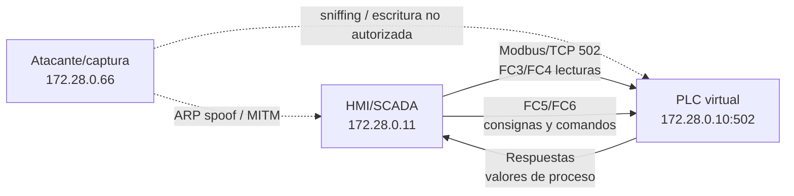

# 4. Escenario propuesto: planta de llenado de un depósito

> Esta sección es una propuesta completa. Si el grupo elige otro proceso, mantén la misma estructura: actores, protocolo, variables, operaciones, arquitectura y uso real.

## 4.1. Descripción del proceso

Una planta de llenado dispone de un depósito de agua (o de un producto líquido) alimentado por una bomba. El PLC controla la bomba y calcula el nivel a partir de un sensor. El HMI muestra el nivel, la temperatura, el caudal y la presión, permite cambiar la consigna de nivel y arrancar o parar la bomba. Un operador vigila el proceso desde la sala de control.

El objetivo del lazo es mantener el nivel alrededor de una consigna (por ejemplo, 60 %). Si el nivel supera el 90 %, se activa una alarma de nivel alto. En una planta real, esta alarma debería complementarse con un **Sistema Instrumentado de Seguridad (SIS)** independiente, con su propio sensor y su propia lógica de parada. En el laboratorio no se implementa el SIS para poder observar el efecto de la manipulación.

## 4.2. Actores y funciones

| Actor | Implementación | Función | Dirección prevista |
|---|---|---|---|
| PLC virtual | `plc_server.py` con PyModbus | Simula el proceso, mantiene registros y atiende peticiones Modbus | 172.28.0.10:502 |
| HMI/SCADA | `hmi_client.py` | Consulta variables, muestra el proceso y escribe consignas/comandos | 172.28.0.11 |
| Captura | `tcpdump` en el PLC | Captura todo el tráfico que pasa por el PLC (HMI y atacante) | 172.28.0.10 |
| Captura HMI (opcional) | Contenedor `capture` | Vista del HMI; no ve el tráfico del atacante | Comparte red del HMI |
| Atacante | `attack_write.py` / cliente Modbus | Lee y escribe variables sin autorización | 172.28.0.66 |
| Opcional: IDS | Suricata/Zeek offline | Detecta escrituras anómalas sobre el PCAP | Fuera de la red o en un contenedor aparte |

## 4.3. Protocolo: Modbus/TCP

Características que deben explicarse en el informe:

- **Modelo cliente/servidor** sobre TCP, puerto 502.
- **MBAP header** de 7 bytes: Transaction ID (2), Protocol ID (2, normalmente 0), Length (2), Unit ID (1).
- **PDU**: Function Code (1 byte) + datos.
- **Function codes** habituales:
  - FC1: leer coils.
  - FC2: leer entradas discretas.
  - FC3: leer registros de retención (*holding registers*).
  - FC4: leer registros de entrada.
  - FC5: escribir un coil.
  - FC6: escribir un registro.
  - FC15/FC16: escribir múltiples coils/registros.
- **Big-endian** para los valores de 16 bits.
- **Sin autenticación, autorización, cifrado, integridad ni protección contra replay.**
- El **Unit ID** identifica al esclavo, pero no es un mecanismo de autenticación.
- Las **excepciones** se devuelven con el bit 0x80 activado en el function code (por ejemplo, 0x83) y un código de excepción.
- Existe **Modbus/TCP Security** (TLS, puerto 802), pero su adopción es limitada; en el laboratorio se usa Modbus/TCP clásico para analizar el caso más común.

## 4.4. Variables de proceso

| Variable | Tag | Dirección Modbus | Tipo | FC | Escala | Quién escribe | Significado |
|---|---|---|---|---|---|---|---|
| Nivel | `LT-101` | HR 0 (40001) | uint16 | 3 | valor/10 % | PLC | Nivel actual del depósito |
| Temperatura | `TT-101` | HR 1 (40002) | uint16 | 3 | valor/10 °C | PLC | Temperatura del líquido |
| Consigna de nivel | `SP-101` | HR 2 (40003) | uint16 | 3/6 | % (0–100) | HMI / atacante | Nivel objetivo |
| Consigna de velocidad | `PV-101` | HR 3 (40004) | uint16 | 3/6 | rpm | HMI / atacante | Velocidad de la bomba |
| Marcha de bomba | `P-101` | CO 0 (00001) | bool | 1/5 | 0/1 | HMI / atacante | Orden de marcha |
| Reset de alarma | `RESET` | CO 1 (00002) | bool | 1/5 | 0/1 | HMI | Reconocimiento de alarma |
| Nivel alto | `LS-101` | DI 0 (10001) | bool | 2 | 0/1 | PLC | Contacto de nivel alto |
| Caudal | `FT-101` | IR 0 (30001) | uint16 | 4 | valor/10 L/min | PLC | Caudal de impulsión |
| Presión | `PT-101` | IR 1 (30002) | uint16 | 4 | valor/10 bar | PLC | Presión de descarga |

**Convención de direcciones:** en el código se usa `zero_mode=True`, por lo que la dirección `0` corresponde a `40001` en la notación tradicional. Deja esta convención escrita en el informe para evitar confusiones.

## 4.5. Operaciones

| Operación | Origen → Destino | FC | Frecuencia | Descripción |
|---|---|---|---|---|
| Lectura de nivel y temperatura | HMI → PLC | 3 | 1 s | Consulta de HR 0–3 |
| Lectura de caudal y presión | HMI → PLC | 4 | 1 s | Consulta de IR 0–1 |
| Lectura de nivel alto | HMI → PLC | 2 | 1 s | Consulta de DI 0 |
| Lectura de estado de bomba | HMI → PLC | 1 | 1 s | Consulta de CO 0–1 |
| Cambio de consigna | HMI → PLC | 6 | Al inicio / manual | Escritura de HR 2 |
| Cambio de velocidad | HMI → PLC | 6 | Al inicio / manual | Escritura de HR 3 |
| Marcha/paro de bomba | HMI → PLC | 5 | Según nivel | Escritura de CO 0 |
| Escritura no autorizada | Atacante → PLC | 6/5 | Manual | Cambio de consigna y/o bomba |

## 4.6. Arquitectura y comunicaciones

```text
                         Red Docker ics_net 172.28.0.0/24
 ┌────────────────┐          Modbus/TCP 502           ┌────────────────┐
 │ HMI / SCADA    │ ────────────────────────────────▶ │ PLC virtual    │
 │ 172.28.0.11    │ ◀──────────────────────────────── │ 172.28.0.10    │
 │ Python client  │   FC1/2/3/4 lecturas, FC5/6 esc.  │ PyModbus server│
 └───────┬────────┘                                   └───────┬────────┘
         │                                                    │
         │        ┌──────────────────────────┐                │
         └───────▶│ Atacante / captura       │◀───────────────┘
                  │ 172.28.0.66              │
                  │ tcpdump, pymodbus, scapy │
                  └──────────────────────────┘
```

Versión Mermaid (si el visor la soporta):



**Punto clave para el informe:** explica que la red del laboratorio es plana a propósito. En una planta real, PLC y HMI estarían en una zona OT segmentada, con un conducto controlado y un firewall industrial; esa diferencia es la base de las medidas de protección de la sección 10.

## 4.7. Uso en una planta industrial real

El escenario se puede trasladar a:

- Estaciones de tratamiento de agua.
- Dosificación de productos químicos.
- Llenado de depósitos en alimentación o bebidas.
- Riego y gestión de agua en agricultura.
- Control de nivel en procesos químicos.
- Sistemas de bombeo y presión.

En todas ellas, el PLC controla actuadores y el HMI permite supervisar y cambiar consignas. La manipulación de una consigna o de una medida puede provocar desbordamientos, falta de producto, dosificación incorrecta, cavitación de la bomba, paradas no planificadas o riesgos para las personas y el medio ambiente.

## 4.8. Consecuencias posibles de la manipulación

| Variable manipulada | Manipulación | Efecto inmediato | Consecuencia potencial |
|---|---|---|---|
| Nivel (`LT-101`) | Valor falso bajo | El operador cree que falta llenar | Desbordamiento |
| Nivel (`LT-101`) | Valor falso alto | El operador cree que está lleno | Parada innecesaria, falta de suministro |
| Consigna (`SP-101`) | Subir a 95–100 % | La bomba trabaja más tiempo | Desbordamiento, vertido |
| Bomba (`P-101`) | Forzar marcha | Llenado continuo | Desbordamiento, sobrepresión |
| Bomba (`P-101`) | Forzar paro | Proceso se detiene | Falta de servicio, pérdida de producción |
| Velocidad (`PV-101`) | Subir a 3000 rpm | Más caudal y presión | Cavitación, daño mecánico, golpe de ariete |
| Temperatura (`TT-101`) | Valor falso | Dosificación o calentamiento incorrecto | Calidad, seguridad química |
| Nivel alto (`LS-101`) | Anular o engañar | No se detecta el nivel alto | Desbordamiento sin alarma |

## 4.9. Alcance y supuestos

- Proceso simplificado, sin dinámica térmica ni hidráulica real.
- PLC virtual, no un PLC físico; no hay requisitos de tiempo real.
- Sin SIS independiente, para poder observar el efecto del ataque.
- Red aislada, sin conexión a Internet.
- No se persigue una auditoría completa ni una certificación IEC 62443; se aplican sus principios como marco de análisis.
